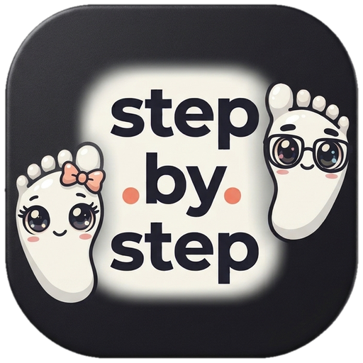

<div align="center">



### One step at a time, together.

A short walk can change a whole day.<br />
Steps, distance, goals and a leaderboard for the whole group, without anyone having to share their location.


</div>

<br />

<table align="center">
<tr>
<td align="center" width="160"><br /><sub><b>Start screen</b><br />Pick a language right away</sub></td>
<td align="center" width="160"><br /><sub><b>Two ways to walk</b><br />Close by or together</sub></td>
<td align="center" width="160"><br /><sub><b>Close by</b><br />A group without a server</sub></td>
<td align="center" width="160"><br /><sub><b>Leaderboard</b><br />Steps and cheers</sub></td>
<td align="center" width="160"><br /><sub><b>Goals</b><br />Day, week, year</sub></td>
</tr>
</table>

<br />

**step.by.step** is a walking app for groups. The group gathers, walks their separate ways or together, and sees how everyone is doing. Email is only used for sign-in, no maps of people, no points chase that demands the phone stays open all day.

<div align="center">

</div>

## Two ways to walk

| Mode | What it is | What is shared |
| :--- | :--- | :--- |
| **Close by** <br /> Group walk without an account | A group nearby walks together. Steps are read from the phone's own health store in the installed app. No GPS, no server, no accounts. | Display name and step total directly between the phones. The group list lives only in memory and disappears when the view closes. |
| **Together live** <br /> Walk further together | The group is spread out and everyone wants to see the situation. Shows the number of active people, steps and distance for the group. | Number of active people, steps and estimated distance. Never names on a map, never anyone's route. |

Both modes use the same logo, the same typefaces, the same colours and the same language choice. Sign in with an email address and a password, or with Google or Apple. Anyone can also try the app without an account.

## What the app includes

| Feature | How it works |
| :--- | :--- |
| **Language from the first second** | Swedish, Danish and English with a flag and the language name already on the start screen. The whole interface switches language, including error messages and the footer. |
| **Own logo everywhere** | The same wordmark in the header, in sign-in, in offline mode, in test mode, as the browser icon, as the Android icon and as the iOS icon. |
| **Several groups at once** | Create as many groups as you like, invite with a link or a six character code, and leave a group after confirming. The last member to leave removes the group. |
| **Name per group** | The app asks what you want to be called in that particular group, so the same person can have different names in different teams. |
| **Goals for every period** | Day, week, weekend, month and year. The group can also set a shared goal that all steps count towards. |
| **Leaderboard per group** | Every group has its own leaderboard with steps, kilometres and cheer hearts. Medals and a crown are handed out across the whole podium. |
| **Celebration when a goal is reached** | When a goal has been reached, an animated scene plays that clearly shows which goal the group achieved. A separate scene for day, week, weekend, month, year and for the shared goal. |
| **Pair two groups** | Share a code or a link. The other group only sees the shared goal and the member count, never personal goals, names or per person steps. |
| **Analysis map** | When two groups are paired, an animated map ranks the groups for day, week or month, with a crown on the leader and a line saying how many steps you are ahead or behind. |
| **Email account** | Create an account with email and password, then sign in right away. Forgot your password? A reset link is sent by email. Google and Apple sign-in is also supported. |
| **Test mode** | **Try the app without an account** opens the screens with sample data in a clearly marked test mode. No fake sign-in, no calls, nothing is saved. |
| **Light and dark** | Two complete themes with the same colour scale, plus mobile adaptation down to 320 px. |

## Privacy

| Question | Answer |
| :--- | :--- |
| Is my location shared? | No. The location is only used on the phone to calculate distance. The server receives the number of metres and the measurement quality, and rejects calls that contain coordinates. |
| Is the offline group saved? | No. Names, steps and the leaderboard live only in memory while the view is open. |
| What data exists about me? | A display name you choose yourself, your steps and, for an account, your email address. No phone number, no address. |
| Can I disappear? | Yes. Leave the group, or delete the account, and your data is removed. |

## How the steps are measured

1. In the installed app, steps are fetched from the phone's health store, HealthKit on iOS and Health Connect on Android, only after you have granted read permission.
2. Distance is calculated as steps times 0.75 metres and is shown as an estimate.
3. In live mode the phone calculates the distance itself while the page is open. Bad fixes, jumps and unreasonable speeds are filtered out before anything is sent.
4. The group card shows the number of walking activities from other members per day. Movement within 15 minutes counts as the same activity, and an activity requires at least 100 metres of accepted distance.
5. Dates and periods are calculated in the Europe/Stockholm time zone, so the week starts on Monday and the weekend consists of Saturday and Sunday.

A web browser cannot read the phone's steps and cannot track reliably in the background. That is why the web version shows a clear notice instead of made up numbers. Real steps and robust measurement require the installed app.

## Tech

| Part | Choice |
| :--- | :--- |
| Interface | React 19, TypeScript 5.8, Vite 6, Motion for animations |
| Typefaces and colour | Outfit for headings, DM Sans for body text, all bundled locally |
| Icons and illustration | Custom SVG components, no icon font and no external downloads |
| Server | Express with TypeScript, data in `data/steps.json` |
| Mobile | Capacitor 8 for Android and iOS, Health Connect and HealthKit for steps |
| Sharing close by | Bluetooth Low Energy directly between phones, custom service `e672a300-c4be-429e-89ec-df1477a51101` |
| Sign-in | Supabase Auth: email and password, Google and Apple |
| Tests | Vitest with Testing Library, 42 tests in 7 files |

## Getting started

```bash
npm install
npm run dev
```

Open **http://localhost:3000**. Vite serves the interface on port 3000 and the API listens on port 3001.

```bash
npm run build        # production build
PORT=3000 npm start  # serve the build with the API
npm test             # 42 tests
npm run lint         # type check with tsc
```

For mobile:

```bash
npm run build && npx cap sync
npx cap open android
npx cap open ios
```

Android requires API 26 or higher. Health Connect and HealthKit need their own permission descriptions and should be tried on physical phones before publishing.

Static hosting, such as GitHub Pages, cannot run the group features because they need the API and a persistent disk. The server needs HTTPS and a domain you control.

## API

| Method | Path | Does |
| :--- | :--- | :--- |
| `DELETE` | `/api/accounts` | Deletes the signed-in person and their data on the server |
| `POST` | `/api/groups` | Creates a group |
| `POST` | `/api/groups/:id/join` | Joins with a code |
| `POST` | `/api/groups/:id/leave` | Leaves the group |
| `POST` | `/api/track` | Sends metres and measurement quality, never coordinates |
| `POST` | `/api/groups/:id/goals` | Adds a goal |
| `PATCH` | `/api/groups/:id/goals/:goalId` | Changes a goal |
| `POST` | `/api/groups/:id/like` | Cheers a member |
| `POST` | `/api/groups/:id/pair-code` | Returns the group's pairing code |
| `GET` | `/api/pair/:code` | Shows what the code leads to |
| `POST` | `/api/groups/:id/partners` | Pairs two groups together |
| `GET` | `/api/state` | Fetches the state of the group |

## Project structure

```text
step.by.step
├── src
│   ├── App.tsx              group view, leaderboard, goals and pairing
│   ├── ModeGate.tsx         the choice between the two modes
│   ├── OfflineGroup.tsx     the group walk close by
│   ├── PrivateMode.tsx      offline statistics and health data
│   ├── Celebration.tsx      animated scenes when goals are reached
│   ├── components           logo, icons, language choice, illustration
│   └── *.test.tsx           tests with Vitest
├── server.ts                API, accounts, groups and goals
├── public                   logo, icons and privacy text
├── art                      illustrations for web and store
├── store                    screenshots and material for Google Play
├── scripts                  icon export, scene rendering and store images
├── android                  Capacitor project for Android
└── ios                      Capacitor project for iOS
```

## Good to know

1. Group data is stored in `data/steps.json`. It is not a production database and has no backup, pruning or self-service export. Set up a real database before public operation.
2. A client can send wrong metre figures. Without further server checks the figures are an estimate, not a verified result.
3. Bluetooth between iPhone and Android, background tracking and health permissions must be tried on real phones before launch.
4. `public/privacypolicy.html` is a draft and not a finished legal privacy text.
5. The package identifier in the mobile projects is temporary and should be changed to one you control yourself.

## License

step.by.step is free to download, use, change and share for education and other noncommercial use. You may not sell the project or earn money from it, either directly or indirectly.

If you want to use step.by.step commercially, for example in a paid app, in a business or in a service you charge for, you need a paid license agreed with nrnworld.one via [nrnworld.one](https://nrnworld.one) or [bynrnworld@gmail.com](mailto:bynrnworld@gmail.com).

Credit to nrnworld.one is always required, and changed versions must be marked and keep the same terms. The full license text is in [LICENSE](LICENSE) and is written in English. The license is source available but not an OSI approved open source license, because commercial use requires an agreement.

```text
step.by.step by nrnworld.one, used for education under the step.by.step Educational License.
https://nrnworld.one
```

<div align="center">
<br />
<sub>Created by <a href="https://nrnworld.one">nrnworld.one</a> · <a href="mailto:bynrnworld@gmail.com">bynrnworld@gmail.com</a></sub>
</div>
