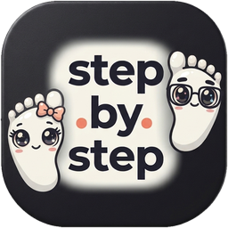

# Byggspec — step.by.step på handleden

**Vad det här är:** en exakt byggbeskrivning av designsidan i `design/smartwatch/index.html`.
Sidan är ett koncept: hur appen *step.by.step* hade sett ut på en smartwatch (Wear OS och watchOS).
Referensbilder finns i samma mapp (`index.html` är facit — öppna den vid sidan om).

**Vem dokumentet är för:** en kodagent som ska bygga om sidan från noll, eller bygga en variant av den,
utan att gissa. Alla siffror, färger, radavstånd och texter nedan är hämtade från den byggda filen.

---

## Innehåll

0. [Regler som gäller hela bygget](#0-regler-som-gäller-hela-bygget) — låsta krav och absoluta förbud
1. [Designtokens](#1-designtokens) — färger, gradienter, mörkt/ljust armband
2. [Typografi](#2-typografi) — Outfit och DM Sans, storlekar per roll
3. [Klockan som komponent](#3-klockan-som-komponent) — chassi, krona, glas, skal-systemet `--u`, ringen
4. [Den illustrerade urtavlan](#4-den-illustrerade-urtavlan-framsidan) — hela SVG:n ordagrant
5. [Sidans struktur](#5-sidans-struktur-ordning-uppifrån-och-ned) — hero, kort, flödesrubriker, asideskort
6. [De 14 vyerna](#6-de-14-vyerna) — markup, CSS och exakt copy per skärm
7. [Komplikationer](#7-komplikationer-efter-de-14-vyerna-fortfarande-i-skarmar)
8. [Fyra textsektioner](#8-efter-klockorna--fyra-sektioner-med-text) — principer, anatomi, arkitektur, bygge, footer
9. [Beteenden](#9-beteenden-javascript) — tema, inblendning, pepp, `--w`
10. [Responsivt](#10-responsivt) — brytpunkter
11. [Fallback utan `color-mix`](#11-fallback-för-webbläsare-utan-color-mix)
12. [Acceptanskriterier](#12-acceptanskriterier--bocka-av-allt) — checklista att bocka av
13. [Så här verifierar du bygget](#13-så-här-verifierar-du-bygget)
14. [Vad som inte ska byggas](#14-vad-som-inte-ska-byggas)

**Läshjälp:** kodblocken är kopieringsbara som de står. Där ett block innehåller `…pokal…`
eller `…sol…` betyder det att en liten ikon-SVG är utelämnad i dokumentet — ta den från
`index.html` (samma element). Allt annat är ordagrant.

---

## 0. Regler som gäller hela bygget

1. **Bygg en enda statisk HTML-fil.** All CSS i en `<style>`, all JS i en `<script>`, all grafik som inline-SVG.
   Inga ramverk, inga byggsteg, inga npm-paket, inga externa requests.
2. **Typsnitt självhostas** (`assets/outfit-latin-wght-normal.woff2`, `assets/dm-sans-latin-wght-normal.woff2`).
   Sidan får inte hämta något från nätet — den ska se likadan ut offline och i en iframe utan nätverk.
3. **Enda bildfilen är `assets/brand-mark.png`** (logotypen). Allt annat är SVG eller CSS.
4. **Följ värdena exakt.** Ändra inte en px, en färg eller en textmening utan att det står här.
5. **Allt innehåll är på svenska**, inklusive etiketter i klockan. Siffror använder hårt mellanslag som
   tusentalsavgränsare: `6 842`, `42 180`, `8 000`.
6. **Sidan ska fungera nedan till 320 px bredd** utan horisontell scroll.
7. **Ingen animation som studsar.** Endast: ring som fylls, siffra som räknas upp, mjuk inblendning.

### Absoluta förbud (tidigare misstag som inte får återkomma)

- ❌ Den runda cirkeln på framsidan får **inte** innehålla en slogan. Den ska visa **steg + mål**:
  `86 %`, `6 842`, `AV 8 000 STEG`. Ingen text som "Ut & Gå i er takt" någonstans på sidan.
- ❌ **Datumet är lördag 7 november 2026** → `LÖR 7 NOV` på urtavlan, `lör 7 nov` i alltid-på-läget.
  Skriv inte fredag.
- ❌ Dela aldrig positioner eller kartor i någon vy. Klockan visar siffror, inte var folk är.
- ❌ Använd inte genomskinliga "glas"-ytor för armband eller paneler — de blir gråa block. Ytor är solida.
- ❌ Sätt inte fast `--w:320` på mobil. Skalan sätts i runtime (avsnitt 9.4).

---

## 1. Designtokens

Lägg exakt dessa i `:root`:

```css
:root{
  /* sidan */
  --page:#faf9f6;
  --ink:#25243a;
  --muted:#7f7c8e;
  --line:#e9e4da;
  --card:#fffefc;
  --coral:#ff704f;
  --coral-deep:#ea6242;
  --lav:#7c60bb;
  --sage:#7cae5c;
  --gold:#e2a83f;
  --shadow:0 26px 60px -34px rgba(35,32,54,.45);

  /* klockans skärm — mörkt armband (standard) */
  --w-bg:#08070e;
  --w-bg-2:#12101d;
  --w-ink:#f7f2ec;
  --w-muted:#9c96ad;
  --w-line:#2b2739;
  --w-chip:rgba(255,112,79,.16);
  --w-chip-ink:#ffa48c;
  --w-track:rgba(255,255,255,.10);
  --w-accent-ink:#ffa48c;
  --w-surface:#1c1930;
  --w-glass:rgba(255,255,255,.06);
  --sheen:rgba(255,255,255,.16);

  /* klockans chassi */
  --case-a:#4a4854;
  --case-b:#141320;
}
```

Ljust armband (byt bara dessa; chassit blir ljusare metall):

```css
html[data-mode="light"]{
  --w-bg:#fbf6ee;
  --w-bg-2:#f4ece0;
  --w-ink:#25243a;
  --w-muted:#8b8698;
  --w-line:#e8ddcd;
  --w-chip:rgba(234,98,66,.13);
  --w-chip-ink:#c1522f;
  --w-track:rgba(37,36,58,.12);
  --w-accent-ink:#c1522f;
  --w-surface:#ffffff;
  --w-glass:rgba(255,255,255,.7);
  --sheen:rgba(255,255,255,.8);
  --case-a:#d8cfc2;
  --case-b:#8f8778;
}
```

**Färgbetydelse (får inte blandas):** korall = mål och rörelse · lavendel = grupp och det andra laget ·
**grönt (sage) = klart — målet är nått** · guld = krona, konceptnotis · grädde `#FBF3E4` = den illustrerade urtavlan.

**Regel:** så fort ett mål är uppfyllt byter vyn accent från korall till grönt. En full ring är alltid grön,
aldrig korall. Det gäller ring, chip och ikon i samma vy — en accent i taget.

### Gradienter och filter som SVG-definitioner

```html
<defs>
  <linearGradient id="gradCoral" x1="0" y1="0" x2="1" y2="1">
    <stop offset="0" stop-color="#ff9670"/>
    <stop offset=".55" stop-color="#ff704f"/>
    <stop offset="1" stop-color="#e85f42"/>
  </linearGradient>
  <linearGradient id="gradSage" x1="0" y1="0" x2="1" y2="1">
    <stop offset="0" stop-color="#c3e8a4"/>
    <stop offset=".55" stop-color="#8ed46c"/>
    <stop offset="1" stop-color="#67a94c"/>
  </linearGradient>
  <linearGradient id="gradLav" x1="0" y1="0" x2="1" y2="1">
    <stop offset="0" stop-color="#c3aef2"/>
    <stop offset="1" stop-color="#7c60bb"/>
  </linearGradient>
  <radialGradient id="sunGlow">
    <stop offset="0" stop-color="#FBE3AE" stop-opacity=".9"/>
    <stop offset="1" stop-color="#FBE3AE" stop-opacity="0"/>
  </radialGradient>
  <filter id="softShadow" x="-40%" y="-40%" width="180%" height="180%">
    <feDropShadow dx="0" dy="2" stdDeviation="2.2" flood-color="#4A3F2C" flood-opacity=".18"/>
  </filter>
</defs>
```

---

## 2. Typografi

```css
@font-face{font-family:'Outfit';src:url('assets/outfit-latin-wght-normal.woff2') format('woff2');
  font-weight:100 900;font-style:normal;font-display:swap}
@font-face{font-family:'DM Sans';src:url('assets/dm-sans-latin-wght-normal.woff2') format('woff2');
  font-weight:100 1000;font-style:normal;font-display:swap}

body{font-family:'DM Sans',system-ui,-apple-system,'Segoe UI',sans-serif;color:var(--ink);background:var(--page);
  -webkit-font-smoothing:antialiased;text-rendering:optimizeLegibility;overflow-x:hidden}
h1,h2,h3,h4{font-family:'Outfit',sans-serif;letter-spacing:-.035em;margin:0;font-weight:700}
```

**Rollfördelning — blanda aldrig:**
Outfit = rubriker och alla stora siffror (steg, procent, klocktid). DM Sans = brödtext, etiketter, knappar.
Siffror sätts med `font-variant-numeric:tabular-nums`.

Alla mått inne i en klocka räknas i `--u` (se avsnitt 3.3). Exempel: `font-size:calc(var(--u)*4.3)`.

| Roll | Storlek | Vikt | Spärrning | Färg |
| :--- | :--- | :--- | :--- | :--- |
| Sidans h1 | `clamp(40px,5.2vw,66px)` | 700 | `-.045em` | `--ink` (andra raden `--coral-deep`) |
| Sidans h2 | `clamp(30px,3.6vw,44px)` | 700 | `-.04em` | `--ink` |
| Sektionsrubrik i flöde | 19px | 700 | `-.025em` | `--ink` |
| Kortrubrik | 16.5px | 700 | `-.025em` | `--ink` |
| Korttext | 12.5px / 1.55 | 400 | — | `--muted` |
| Kortmeta | 10.5px | 800 | `.1em`, versaler | `--muted` 80 % |
| Eyebrow | 11px | 800 | `.2em`, versaler | `--coral-deep` |
| Klockans stora siffra | `--u*19` | 700 | `-.05em` | `--w-ink` |
| Klockans etikett | `--u*4.3` | 600 | — | `--w-muted` |
| Klockans eyebrow | `--u*3.3` | 800 | `.19em`, versaler | `--w-muted` |

---

## 3. Klockan som komponent

### 3.1 Markup (återanvänds 16 gånger: hero + 14 kort + 1 bakomliggande)

```html
<div class="watch">
  <div class="case"><span class="crown"></span>
    <div class="screen">
      <!-- innehåll: ring-svg, .face med innehåll, .glass sist -->
      <div class="glass"></div>
    </div>
  </div>
</div>
```

### 3.2 Chassi, krona, glas

```css
.watch{position:relative;aspect-ratio:1;margin:0 auto;isolation:isolate;--w:300}
.watch::before{ /* mark skugga under klockan */
  content:"";position:absolute;left:12%;right:12%;bottom:-7%;height:10%;z-index:0;border-radius:50%;
  background:radial-gradient(closest-side,rgba(30,26,48,.30),rgba(30,26,48,0));filter:blur(4px);
}
.case{
  position:absolute;inset:0;border-radius:50%;
  background:conic-gradient(from 200deg,
    var(--case-a),var(--case-b) 14%,var(--case-a) 27%,#0b0a12 41%,
    var(--case-a) 58%,var(--case-b) 72%,var(--case-a) 86%,#0b0a12 97%,var(--case-a));
  box-shadow:
    0 34px 54px -26px rgba(28,24,44,.6),
    0 4px 10px -4px rgba(28,24,44,.35),
    inset 0 0 0 1px rgba(255,255,255,.14),
    inset 0 -2px 3px rgba(0,0,0,.6);
  z-index:2;
}
.crown{
  position:absolute;right:-5px;top:38%;width:9px;height:12%;z-index:3;border-radius:0 5px 5px 0;
  background:
    repeating-linear-gradient(to bottom,rgba(255,255,255,.10) 0 1px,rgba(0,0,0,.35) 1px 3.5px),
    linear-gradient(90deg,#100f18,#5c5a68 42%,#2b2a36);
  box-shadow:2px 0 5px rgba(0,0,0,.45),inset 0 0 0 .5px rgba(255,255,255,.14);
}
.crown::after{ /* den lilla knappen under kronan */
  content:"";position:absolute;left:0;top:124%;width:9px;height:9%;border-radius:3px;
  background:linear-gradient(90deg,#100f18,#4c4a57 45%,#232230);box-shadow:2px 0 4px rgba(0,0,0,.35);
}
.screen{
  position:absolute;inset:3.4%;border-radius:50%;overflow:hidden;
  --u:calc(var(--w,300) * .00932px);
  background:radial-gradient(120% 100% at 30% 0%,var(--w-bg-2),var(--w-bg) 62%);
  box-shadow:inset 0 0 0 1px rgba(255,255,255,.05),inset 0 18px 34px rgba(0,0,0,.45);
  z-index:1;
}
.glass{ /* glans överst, får aldrig ta emot klick */
  position:absolute;inset:0;border-radius:50%;pointer-events:none;z-index:9;
  background:
    radial-gradient(120% 70% at 26% 4%,var(--sheen),transparent 46%),
    radial-gradient(70% 50% at 82% 96%,rgba(255,255,255,.05),transparent 60%);
  box-shadow:inset 0 0 0 1.5px rgba(255,255,255,.05),inset 0 -20px 34px rgba(0,0,0,.42);
  opacity:.9;
}
.glass::after{ /* reflex */
  content:"";position:absolute;left:-30%;top:-40%;width:90%;height:150%;
  background:linear-gradient(102deg,transparent 30%,rgba(255,255,255,.14) 46%,transparent 60%);
  transform:rotate(10deg);opacity:.5;
}
```

### 3.3 Skalsystemet `--u` (viktigast av allt)

`--u` är **1/107 av klockans bredd**. Allt i en urtavla mäts i `--u`, aldrig i px.
`--w` sätts per klocka: 320 (hero), 224 (bakre hero-klockan), 252 (kort), och **i runtime** för alla
(avsnitt 9.4). Med `--w:252` blir `--u ≈ 2.35px`, så `--u*19` (stora siffran) ≈ 44 px.

```css
/* exempel på skalan i praktiken */
.face{padding:13% 15%;gap:calc(var(--u)*1.4)}
.big-num{font-size:calc(var(--u)*19)}   /* 6 842 */
.chip{font-size:calc(var(--u)*3.7)}
```

### 3.4 Ringen (dagens mål)

```html
<svg class="ring" viewBox="0 0 100 100" aria-hidden="true">
  <circle class="track" cx="50" cy="50" r="45" pathLength="100"/>
  <circle class="fill" cx="50" cy="50" r="45" pathLength="100" style="--off:14"/>
</svg>
```

`--off` = **100 − procent**. 86 % mål → `--off:14`.

```css
.ring{position:absolute;inset:4.4%;width:91.2%;height:91.2%;transform:rotate(-90deg);z-index:1}
.ring circle{fill:none;stroke-linecap:round}
.ring .track{stroke:var(--w-track);stroke-width:2.4}
.ring .fill{
  stroke:url(#gradCoral);stroke-width:3;stroke-dasharray:100 100;stroke-dashoffset:var(--off,0);
  filter:drop-shadow(0 0 2px rgba(255,112,79,.55));
  animation:ringDraw 1.7s cubic-bezier(.2,.8,.2,1) both;
}
@keyframes ringDraw{from{stroke-dashoffset:100}}

/* målet nått: ringen, chipen och trofén lyser grönt i stället för korall */
.ring--done .fill{stroke:url(#gradSage);filter:drop-shadow(0 0 3px rgba(131,200,101,.6))}
.screen--done{box-shadow:inset 0 0 0 1px rgba(131,200,101,.2),inset 0 18px 34px rgba(0,0,0,.45),
  inset 0 0 calc(var(--u)*11) rgba(131,200,101,.16)}
```

Är målet nått sätts **båda** klasserna: `class="screen screen--done"` och `class="ring ring--done"`.
Den inre gröna glöden i `.screen--done` är det som får skärmen att "lysa" — den ska vara subtil
(16 % alpha), aldrig en grön lampa.

### 3.5 `.face` — innehållslagret

```css
.face{
  position:absolute;inset:0;z-index:2;
  display:flex;flex-direction:column;align-items:center;justify-content:center;
  text-align:center;color:var(--w-ink);padding:13% 15%;gap:calc(var(--u)*1.4);
}
.face-eyebrow{font-size:calc(var(--u)*3.3);font-weight:800;letter-spacing:.19em;text-transform:uppercase;
  color:var(--w-muted);margin:0;line-height:1.2}
.big-num{font-family:'Outfit';font-weight:700;font-size:calc(var(--u)*19);line-height:.92;
  letter-spacing:-.05em;margin:0;font-variant-numeric:tabular-nums;font-feature-settings:"tnum" 1}
.big-num.sm{font-size:calc(var(--u)*12.5)}
.face-label{font-size:calc(var(--u)*4.3);font-weight:600;color:var(--w-muted);margin:0;line-height:1.25}
.chip{display:inline-flex;align-items:center;gap:calc(var(--u)*1.6);
  font-size:calc(var(--u)*3.7);font-weight:800;letter-spacing:.01em;
  padding:calc(var(--u)*1.5) calc(var(--u)*3.4);border-radius:99px;
  background:var(--w-chip);color:var(--w-chip-ink);white-space:nowrap}
.chip.mute{background:rgba(255,255,255,.09);color:var(--w-muted)}
.live-dot{width:calc(var(--u)*1.9);height:calc(var(--u)*1.9);border-radius:50%;background:#83c865;
  box-shadow:0 0 0 calc(var(--u)*.9) rgba(131,200,101,.18);display:inline-block}
```

**Säker zon:** allt innehåll ska hålla sig inom cirka 78 % av diametern. Därför `padding:13% 15%`,
aldrig mindre än `11%`.

---

## 4. Den illustrerade urtavlan (framsidan)

Det här är sidans huvudmotiv: en liten handritad värld i grädde, med sol, backar, en stig, en hund och
tre som går — och en streckad vit cirkel där stegen och målet bor.

Används som `<symbol>` i en dold SVG överst i `<body>`:

```html
<svg width="0" height="0" style="position:absolute" aria-hidden="true">
  <defs>… (se avsnitt 1) …</defs>
  <symbol id="faceIllu" viewBox="0 0 200 200">
    <!-- exakt innehåll nedan -->
  </symbol>
</svg>
```

I klockan:

```html
<div class="screen screen--illu">
  <svg class="illu-face" viewBox="0 0 200 200" aria-hidden="true"><use href="#faceIllu"/></svg>
  <div class="glass"></div>
</div>
```

```css
.illu-face{position:absolute;inset:0;width:100%;height:100%}
.screen--illu .glass{opacity:.55}   /* svagare glans över illustrationen */
```

### 4.1 Innehållet i `#faceIllu` — kopiera ordagrant

```svg
<!-- himmel -->
<rect width="200" height="200" fill="#FBF3E4"/>
<circle cx="160" cy="44" r="46" fill="url(#sunGlow)"/>

<!-- sol -->
<circle cx="160" cy="42" r="10.5" fill="#F5C64F"/>
<circle cx="160" cy="42" r="16" fill="none" stroke="#E8B94E" stroke-width="1" stroke-dasharray="1.8 4.4" opacity=".9"/>
<g stroke="#E8B94E" stroke-width="1.5" stroke-linecap="round" opacity=".75">
  <path d="M160 21v-4.6"/>
  <path d="M181 42h4.4"/>
  <path d="M175.4 27l3.2-3.2"/>
</g>

<!-- fåglar -->
<g stroke="#8B8070" stroke-width="1.1" stroke-linecap="round" fill="none" opacity=".55">
  <path d="M44 47q3-2.6 5.6 0q2.6-2.6 5.6 0"/>
  <path d="M60 39q2.2-2 4.2 0q2-2 4.2 0"/>
</g>

<!-- backar -->
<path d="M0 149 C24 133 44 139 66 145 C92 152 112 137 136 139 C160 141 178 149 200 145 L200 200 L0 200 Z" fill="#DFE8C6"/>
<path d="M0 171 C30 155 58 167 88 171 C120 175 150 163 200 171 L200 200 L0 200 Z" fill="#C6D6AC"/>
<path d="M-2 186 C34 180 72 190 104 188 C140 186 172 178 202 182" fill="none"
      stroke="#F4E5C9" stroke-width="9" stroke-linecap="round"/>

<!-- gräs och blomster -->
<g stroke="#8FA97C" stroke-width="1.5" stroke-linecap="round" fill="none" opacity=".95">
  <path d="M22 174v-7M22 169c-3-1.6-4.2-3.6-4.2-5.8M22 169c3-1.6 4.2-3.6 4.2-5.8"/>
  <path d="M184 176v-6M184 172c-2.6-1.4-3.6-3.2-3.6-5M184 172c2.6-1.4 3.6-3.2 3.6-5"/>
</g>
<circle cx="31" cy="165" r="1.7" fill="#F0A47A"/>
<circle cx="174" cy="166" r="1.5" fill="#F5C64F"/>
<circle cx="92" cy="166" r="1.4" fill="#F0A47A" opacity=".8"/>

<!-- text -->
<text x="100" y="34" text-anchor="middle" font-family="Outfit" font-weight="800"
      font-size="5.4" letter-spacing=".1" fill="#6F6656">step<tspan fill="#E8834F">.</tspan>by<tspan fill="#E8834F">.</tspan>step</text>
<text x="100" y="80" text-anchor="middle" font-family="Outfit" font-weight="600"
      font-size="29" letter-spacing="-1.6" fill="#2E2A3B">09:41</text>
<text x="100" y="96" text-anchor="middle" font-family="DM Sans" font-weight="800"
      font-size="5.6" letter-spacing="1.5" fill="#8B8070">LÖR 7 NOV</text>

<!-- liten cirkel: steg och mål -->
<g filter="url(#softShadow)">
  <circle cx="62" cy="136" r="25" fill="#FFFCF4"/>
  <circle cx="62" cy="136" r="25" fill="none" stroke="#2E2A3B" stroke-width="1.1"
          stroke-dasharray="3 4.2" stroke-linecap="round" opacity=".62"/>
</g>
<circle cx="62" cy="136" r="19.5" fill="none" stroke="#EADFC8" stroke-width="3"/>
<circle cx="62" cy="136" r="19.5" fill="none" stroke="#E8834F" stroke-width="3"
        stroke-linecap="round" pathLength="100" stroke-dasharray="86 100"
        transform="rotate(-90 62 136)"/>
<text x="62" y="125" text-anchor="middle" font-family="DM Sans" font-weight="800"
      font-size="4.6" letter-spacing=".3" fill="#C9622F">86 %</text>
<text x="62" y="138.4" text-anchor="middle" font-family="Outfit" font-weight="700"
      font-size="9.6" letter-spacing="-.3" fill="#2E2A3B">6 842</text>
<text x="62" y="147.4" text-anchor="middle" font-family="DM Sans" font-weight="800"
      font-size="3.3" letter-spacing=".45" fill="#8B8070">AV 8 000 STEG</text>

<!-- hunden -->
<g transform="translate(100,184) scale(1.08)">
  <ellipse cx="1" cy="1.2" rx="8" ry="1.5" fill="#5E6B4A" opacity=".16"/>
  <path d="M-3.4 -1.2v2.4M3.6 -1.2v2.4" stroke="#C98F63" stroke-width="1.8" stroke-linecap="round"/>
  <path d="M5.8 -6.4c3.4.8 4-1 3.6-3.2-1.6 1.4-2.6 1.4-3.8 1" fill="#F6EFE2"/>
  <ellipse cx="0" cy="-4.8" rx="6.2" ry="3.6" fill="#F6EFE2"/>
  <circle cx="-5.6" cy="-7.6" r="3.4" fill="#FFFDF7"/>
  <path d="M-7.4 -9.8c-1.2-1-2.2-.6-2.6.2.4 1.6 1.4 2.2 2.6 2.2Z" fill="#C98F63"/>
  <circle cx="-6.4" cy="-8.2" r=".55" fill="#3B3444"/>
  <circle cx="-8.7" cy="-7.4" r=".7" fill="#3B3444"/>
</g>

<!-- tre som går: korall, sage, blå -->
<g transform="translate(118,184) scale(1.16)">
  <ellipse cx="0" cy="1.4" rx="7" ry="1.5" fill="#5E6B4A" opacity=".16"/>
  <path d="M-2.4 0L-2.8 -7.2M2.4 0L3 -7.2" stroke="#3B3444" stroke-width="2.1" stroke-linecap="round"/>
  <path d="M-5.2 -7Q-6 -18.6 0 -18.6Q6 -18.6 5.2 -7Z" fill="#E8834F"/>
  <path d="M-4.8 -14.6L-7.2 -9.8" stroke="#E8834F" stroke-width="2" stroke-linecap="round"/>
  <path d="M4.8 -14.6L6.8 -10.2" stroke="#E8834F" stroke-width="2" stroke-linecap="round"/>
  <circle cx="0" cy="-22.8" r="4.5" fill="#F3C9A4"/>
  <path d="M-4.5 -23.6a4.5 4.5 0 0 1 9 0q-4.5 2.6 -9 0Z" fill="#3B3444"/>
  <circle cx="0" cy="-27.6" r="2" fill="#3B3444"/>
</g>

<g transform="translate(133,184) scale(1.16)">
  <ellipse cx="0" cy="1.4" rx="7" ry="1.5" fill="#5E6B4A" opacity=".16"/>
  <path d="M-2.4 0L-2.8 -7.2M2.4 0L3 -7.2" stroke="#3B3444" stroke-width="2.1" stroke-linecap="round"/>
  <path d="M-5.2 -7Q-6 -18.6 0 -18.6Q6 -18.6 5.2 -7Z" fill="#6E8C64"/>
  <path d="M-4.8 -14.6L-6.6 -10.4" stroke="#6E8C64" stroke-width="2" stroke-linecap="round"/>
  <path d="M4.8 -14.6L7 -11.4" stroke="#6E8C64" stroke-width="2" stroke-linecap="round"/>
  <rect x="6.4" y="-12.6" width="4.4" height="4.6" rx="1.2" fill="#F0C88A"/>
  <circle cx="0" cy="-22.8" r="4.5" fill="#E0AC80"/>
  <path d="M-4.6 -23.4q-1 -4.6 2.2 -5.4q3.4 -.4 3.8 3.4q.2 1.8 -1 2.2q-.4 -3 -2.4 -3q-2 0 -2.6 2.8Z" fill="#4A3529"/>
</g>

<g transform="translate(148,184) scale(1.16)">
  <ellipse cx="0" cy="1.4" rx="7" ry="1.5" fill="#5E6B4A" opacity=".16"/>
  <path d="M-2.4 0L-2.8 -7.2M2.4 0L3 -7.2" stroke="#3B3444" stroke-width="2.1" stroke-linecap="round"/>
  <path d="M-5.2 -7Q-6 -18.6 0 -18.6Q6 -18.6 5.2 -7Z" fill="#87A6B8"/>
  <path d="M-4.8 -14.6L-7.2 -10.4" stroke="#87A6B8" stroke-width="2" stroke-linecap="round"/>
  <path d="M4.8 -14.6L6.6 -10.8" stroke="#87A6B8" stroke-width="2" stroke-linecap="round"/>
  <circle cx="0" cy="-22.8" r="4.5" fill="#C98F63"/>
  <path d="M-4.6 -24.2q.6 -4.4 4.6 -4.4q4 0 4.6 4.4q-4.6 2 -9.2 0Z" fill="#E8C15F"/>
  <rect x="1" y="-24.6" width="6.6" height="1.6" rx=".8" fill="#E8C15F"/>
</g>
```

### 4.2 Regler för illustrationen

- **Cirkeln är hjälten.** Den streckade ytterkanten (`3 4.2`) är en "lapp" ovanpå landskapet, inte en
  ram runt allt. Den ligger `cx=62 cy=136 r=25`, alltså nedre vänster.
- **Cirkelns innehåll, uppifrån och ned:** `86 %` (DM Sans 800, 4.6, `#C9622F`), `6 842`
  (Outfit 700, 9.6), `AV 8 000 STEG` (DM Sans 800, 3.3, spärrning .45). Ingen slogan, ingen
  "Ut & Gå i er takt".
- **Procentbågen** är `stroke-dasharray="86 100"` på en cirkel med `pathLength="100"`, roterad `-90`
  kring sin egen mitt, med spår `#EADFC8` under.
- **Stigen** är en enda ljus strok (`#F4E5C9`, bredd 9) med rundade ändar, inte en polygon.
- **Gruppen går åt höger**, hund först (`translate(100,184) scale(1.08)`), sedan tre vuxna på
  x=118, 133, 148 i `scale(1.16)`. Skuggor under fötterna är ellipser med `opacity=".16"`.
- **Solen** har en streckad gloria (`1.8 4.4`) och tre korta strålar, inte tolv.
- Färger: himmel `#FBF3E4`, backar `#DFE8C6` / `#C6D6AC`, sol `#F5C64F` + `#E8B94E`,
  hud `#F3C9A4` / `#E0AC80` / `#C98F63`, kläder `#E8834F` / `#6E8C64` / `#87A6B8`, hatt `#E8C15F`,
  ink `#2E2A3B`, dämpad text `#8B8070`.
- **Klocktiden `09:41`** är statisk text (inte live), i Outfit 600, 29 px, `letter-spacing:-1.6`.

---

## 5. Sidans struktur (ordning uppifrån och ned)

```text
<svg width="0" height="0">          ← alla symboler och gradienter
<header class="topbar">             ← sticky, 66 px
<main>
  1. .hero                          ← rubrik + den illustrerade klockan + 2 flytande chips
  2. #skarmar   "Alla skärmar"      ← 14 klockor i 5 flödesgrupper
       └ .comp-head + .band         ← komplikationer på främmande urtavla
  3. #principer "Designprinciper"   ← 6 principkort
  4. #anatomi   "Mått och typografi"← anatomi-SVG + förklaringar
  5. #bryggan   "Arkitektur"        ← telefon → Bluetooth → klocka
  6. #bygga     "Om det skulle byggas" ← 3 kort + konceptnotis
<footer>                            ← logotyp + "Koncept · på handleden"
```

```css
.wrap{width:min(1180px,calc(100% - 48px));margin-inline:auto}
.section{padding:88px 0 0}
.section-head{max-width:640px;margin-bottom:44px}
.section-head h2{font-size:clamp(30px,3.6vw,44px);line-height:1.02;margin:14px 0 14px;letter-spacing:-.04em}
.section-head .lede{font-size:15px}
.lede{color:var(--muted);font-size:15.5px;max-width:48ch}
.eyebrow{font-size:11px;font-weight:800;letter-spacing:.2em;text-transform:uppercase;
  color:var(--coral-deep);display:flex;align-items:center;gap:9px}
.eyebrow::before{content:"";width:22px;height:1.5px;background:currentColor;border-radius:2px;opacity:.55}
```

### 5.1 Topbar

```html
<header class="topbar">
  <div class="wrap topbar-inner">
    <span class="brand">
      <span class="brand-mark"></span>
      <span class="wordmark">step<span class="dot">.</span>by<span class="dot">.</span>step</span>
    </span>
    <span class="top-spacer"></span>
    <span class="pill"><i></i> Designkoncept</span>
    <button class="theme-btn" id="themeBtn" type="button" aria-pressed="false">
      <span class="knob">
        <svg class="sun" …sol…></svg>
        <svg class="moon" …måne…></svg>
      </span>
      <span class="lbl" id="themeLbl">Ljust armband</span>
    </button>
  </div>
</header>
```

```css
.topbar{position:sticky;top:0;z-index:50;backdrop-filter:blur(14px);-webkit-backdrop-filter:blur(14px);
  background:color-mix(in srgb,var(--page) 82%,transparent);
  border-bottom:1px solid color-mix(in srgb,var(--line) 75%,transparent)}
.topbar-inner{display:flex;align-items:center;gap:14px;height:66px}
.brand{display:flex;align-items:center;gap:9px;font-family:'Outfit';font-weight:800;font-size:19px;letter-spacing:-.045em}
.brand-mark{width:34px;height:34px;border-radius:11px;overflow:hidden;display:block;flex:none;background:#21212b;
  box-shadow:0 5px 14px -6px rgba(36,31,43,.55),inset 0 0 0 1px rgba(255,255,255,.06)}
.brand-mark img{width:100%;height:100%;display:block;object-fit:cover}
.brand .dot{color:var(--coral)}
.top-spacer{flex:1}
.pill{display:inline-flex;align-items:center;gap:7px;font-size:11px;font-weight:800;letter-spacing:.06em;
  text-transform:uppercase;border:1px solid var(--line);border-radius:99px;padding:7px 12px;color:var(--muted);
  background:var(--card);white-space:nowrap}
.pill i{width:6px;height:6px;border-radius:50%;background:var(--sage);box-shadow:0 0 0 3px rgba(124,174,92,.18)}
.theme-btn{display:inline-flex;align-items:center;gap:8px;border:1px solid var(--line);background:var(--card);
  color:var(--ink);font:inherit;font-size:12px;font-weight:700;border-radius:99px;padding:7px 13px 7px 8px;
  cursor:pointer;transition:.2s}
.theme-btn .knob{width:24px;height:24px;border-radius:50%;display:grid;place-items:center;
  background:var(--ink);color:var(--page)}
.theme-btn .knob svg{width:14px;height:14px}
.theme-btn .moon{display:none}
html[data-mode="light"] .theme-btn .moon{display:block}
html[data-mode="light"] .theme-btn .sun{display:none}
```

### 5.2 Hero — exakt copy

```html
<section class="hero">
  <div class="wrap hero-grid">
    <div class="hero-copy">
      <p class="eyebrow">Koncept · Wear OS &amp; watchOS</p>
      <h1>Samma steg.<br /><em>Mycket mindre skärm.</em></h1>
      <p class="lede">
        En klocka ska inte vara en telefon i miniatyr. Den ska svara på tre frågor på två
        sekunder: Hur går det för mig? Hur går det för oss? Och vem behöver en pepp?
        Framsidan är en liten värld att titta på — och i cirkeln bor stegen och målet.
      </p>
      <div class="hero-meta">
        <span><b>2 s</b> till svar</span>
        <span><b>1</b> tryck till pepp</span>
        <span><b>0</b> positioner delade</span>
      </div>
      <p class="hero-note">
        <svg …gnistsymbol…></svg>
        <span>Ritad med appens egna färger, typsnitt och siffror. Cirkeln ersätter inget — den visar 6 842 steg och 86 % av dagens mål.</span>
      </p>
    </div>

    <div class="hero-stage">
      <div class="halo" aria-hidden="true"></div>
      <div class="watch watch--main">…illustrerad urtavla…</div>
      <div class="watch watch--back">…dagens steg med ring…</div>
      <div class="float-chip chip-live">…Just nu / 3 vänner ute…</div>
      <div class="float-chip chip-pepp">…Pepp idag / 8 hjärtan…</div>
    </div>
  </div>
</section>
```

```css
.hero{position:relative;padding:76px 0 30px;overflow:hidden}
.hero::before,.hero::after{content:"";position:absolute;border-radius:50%;filter:blur(2px);pointer-events:none;z-index:0}
.hero::before{width:620px;height:620px;right:-160px;top:-190px;
  background:radial-gradient(circle at 40% 40%,rgba(255,112,79,.14),transparent 66%)}
.hero::after{width:520px;height:520px;left:-200px;bottom:-260px;
  background:radial-gradient(circle at 50% 50%,rgba(124,96,187,.13),transparent 68%)}
.hero-grid{position:relative;z-index:1;display:grid;grid-template-columns:minmax(0,1.02fr) minmax(0,1fr);
  gap:30px;align-items:center}
.hero-copy h1{font-size:clamp(40px,5.2vw,66px);line-height:.98;letter-spacing:-.045em;margin:18px 0 20px}
.hero-copy h1 em{font-style:normal;color:var(--coral-deep)}
.hero-copy .lede{font-size:16.5px;max-width:44ch}
.hero-meta{display:flex;flex-wrap:wrap;gap:10px;margin-top:26px}
.hero-meta span{display:inline-flex;align-items:center;gap:8px;font-size:12px;font-weight:700;color:var(--ink);
  background:var(--card);border:1px solid var(--line);border-radius:99px;padding:9px 14px;box-shadow:0 1px 0 #fff inset}
.hero-meta b{font-family:'Outfit';font-size:14px;color:var(--coral-deep);font-weight:800}
.hero-note{margin-top:26px;font-size:12.5px;color:var(--muted);display:flex;gap:10px;align-items:flex-start;max-width:42ch}
.hero-note svg{width:17px;height:17px;flex:none;margin-top:2px;color:var(--sage)}

.hero-stage{position:relative;min-height:560px;display:grid;place-items:center}
.halo{position:absolute;inset:6% 2% 10% 6%;border-radius:50%;filter:blur(6px);
  background:
    radial-gradient(closest-side,rgba(255,112,79,.16),transparent 72%),
    radial-gradient(closest-side at 70% 75%,rgba(124,96,187,.18),transparent 70%)}
.hero-stage .watch--main{--w:320;width:min(320px,72%);transform:rotate(-7deg) translate(-26px,26px);z-index:3}
.hero-stage .watch--back{position:absolute;width:min(224px,52%);--w:224;right:3%;top:4%;
  transform:rotate(8deg);z-index:2;opacity:.97;filter:drop-shadow(0 30px 40px rgba(32,28,48,.28))}
.float-chip{position:absolute;z-index:4;display:flex;align-items:center;gap:9px;background:var(--card);
  border:1px solid var(--line);border-radius:14px;padding:9px 13px 9px 9px;box-shadow:var(--shadow);
  font-size:11.5px;font-weight:700;white-space:nowrap}
.float-chip .mini{width:26px;height:26px;border-radius:8px;display:grid;place-items:center;flex:none}
.float-chip .mini svg{width:15px;height:15px}
.float-chip small{display:block;font-size:9.5px;font-weight:600;color:var(--muted);letter-spacing:.02em}
.chip-live{top:14%;left:0;transform:rotate(-3deg)}
.chip-live .mini{background:rgba(124,174,92,.18);color:#4e7c37}
.chip-pepp{bottom:11%;left:4%;transform:rotate(2deg)}
.chip-pepp .mini{background:rgba(255,112,79,.16);color:var(--coral-deep)}
```

De två flytande chippen: `Just nu` / `3 vänner ute` och `Pepp idag` / `8 hjärtan`.
De ska ligga utanför klockan, lätt roterade, som små lappar i luften.

### 5.3 Kortvikning (används av alla 14 vyer)

```html
<figure class="screen-card reveal">
  <div class="watch"> … </div>
  <figcaption>
    <span class="num">01</span>
    <h3>Parkoppla</h3>
    <p>Ett varv på handleden och ett tryck i telefonen. Sedan finns grupperna där.</p>
    <p class="meta">Uppstart · en gång</p>
  </figcaption>
</figure>
```

```css
.grid-screens{display:grid;grid-template-columns:repeat(3,minmax(0,1fr));gap:22px}
.screen-card{position:relative;display:flex;flex-direction:column;align-items:center;padding:34px 22px 26px;
  border-radius:26px;background:linear-gradient(180deg,var(--card),color-mix(in srgb,var(--card) 70%,var(--page)) 100%);
  border:1px solid var(--line);box-shadow:0 1px 0 #fff inset,0 22px 44px -40px rgba(35,32,54,.5);
  transition:transform .35s cubic-bezier(.2,.8,.2,1),box-shadow .35s,border-color .35s}
.screen-card:hover{transform:translateY(-6px);box-shadow:0 1px 0 #fff inset,0 34px 60px -40px rgba(35,32,54,.55);
  border-color:color-mix(in srgb,var(--coral) 26%,var(--line))}
.screen-card .watch{--w:252;width:min(252px,94%)}
.screen-card figcaption{margin-top:30px;text-align:center;display:flex;flex-direction:column;align-items:center;flex:1}
.screen-card .num{display:inline-grid;place-items:center;width:22px;height:22px;border-radius:7px;
  background:rgba(255,112,79,.13);color:var(--coral-deep);font-family:'Outfit';font-size:11px;font-weight:800;
  margin-bottom:10px}
.screen-card h3{font-size:16.5px;letter-spacing:-.025em;margin-bottom:7px}
.screen-card figcaption p{font-size:12.5px;color:var(--muted);line-height:1.55;max-width:27ch}
.screen-card .meta{margin-top:auto;padding-top:13px;font-size:10.5px;font-weight:800;letter-spacing:.1em;
  text-transform:uppercase;color:rgba(127,124,142,.85)}
```

`margin-top:auto` på `.meta` är viktigt: då ligger metaraden i samma höjd i alla kort i en rad,
även när texterna är olika långa.

### 5.4 Flödesrubrik (mellan grupperna av skärmar)

```html
<div class="flow-head">
  <span class="flow-num">01</span>
  <h3>Första gången</h3>
  <p>Klockan ärver gruppen från telefonen. Inget konto, inget lösenord, ingen ny inloggning.</p>
</div>
```

```css
.flow-group{margin-top:46px}
.flow-head{display:grid;grid-template-columns:auto 1fr;column-gap:12px;row-gap:6px;align-items:center;
  margin-bottom:20px}
.flow-num{font-family:'Outfit';font-weight:800;font-size:11px;letter-spacing:.1em;color:var(--coral-deep);
  background:rgba(255,112,79,.12);padding:4px 8px;border-radius:6px}
.flow-head h3{font-size:19px;letter-spacing:-.025em}
.flow-head p{grid-column:2;font-size:12.5px;color:var(--muted);max-width:66ch;line-height:1.55}
```

### 5.5 Asideskortet (lavendel)

Används en gång, som tredje kolumn i första flödet, för att bryta rytmen av klockor:

```html
<article class="note-card reveal">
  <span class="note-ico"><svg …sköld…></svg></span>
  <h3>Ingen inloggning på handleden</h3>
  <p>Kontot, grupperna och historiken bor i telefonen. Klockan visar bara det som redan är ditt — och frågar aldrig efter ett lösenord.</p>
  <p class="note-meta">Säkerhet · kort väg</p>
</article>
```

```css
.note-card{display:flex;flex-direction:column;justify-content:center;gap:10px;padding:34px 30px;
  border-radius:26px;align-self:center;
  background:linear-gradient(180deg,rgba(124,96,187,.13),rgba(124,96,187,.07));
  border:1px solid rgba(124,96,187,.28)}
.note-card .note-ico{width:40px;height:40px;border-radius:13px;display:grid;place-items:center;
  background:var(--lav);color:#fff;margin-bottom:8px;box-shadow:0 8px 18px -10px rgba(124,96,187,.8)}
.note-card .note-ico svg{width:21px;height:21px}
.note-card h3{font-size:16px;letter-spacing:-.025em}
.note-card p{font-size:12.5px;color:var(--muted);line-height:1.6;max-width:30ch}
.note-card .note-meta{font-size:10.5px;font-weight:800;letter-spacing:.1em;text-transform:uppercase;
  color:rgba(146,144,158,.9);margin-top:4px}
```

---

## 6. De 14 vyerna

Sektionens rubrik:

> **Alla skärmar** (eyebrow)
> **Hela appen, vy för vy.**
> Fjorton skärmar, en cirkel i taget. Först parkopplingen, sedan dagen, gruppen, det andra laget —
> och till slut firandet och vilan.

Ordningen är låst: **01–14**. Numret i kortet är samma som i flödesrubriken.

| Flöde | Vyer |
| :--- | :--- |
| 01 Första gången | 01 Parkoppla · 02 Välj grupp · (asideskort) |
| 02 Under dagen | 03 Dagens steg · 04 Veckan · 05 Målen |
| 03 Gruppen | 06 Topplistan · 07 Pepp på handleden · 08 Tillsammans live |
| 04 Nära — och mot ett annat lag | 09 Bara här · 10 Race mot partner · 11 Analyskarta |
| 05 Firande och vila | 12 Målet nått · 13 Alltid på · 14 Inställningar |

**Alla siffror måste hänga ihop mellan vyerna** (det är en och samma dag, lördag 7 nov 2026, kl. 09:41):
dagens steg `6 842` av `8 000` = `86 %` · sträcka `5,1 km` · veckan `34 210` av `50 000` = `68 %` ·
månad `34 %` · gruppen Lunchpromenaden `42 180` mot Kontorsgänget `40 940` = `1 240` före ·
tillsammans `83 120` av `100 000`.

### 6.1 Vy 01 — Parkoppla

*Uppstart, en gång.*

```html
<div class="face face--pair">
  <span class="pair-icon"></span>
  <p class="face-eyebrow">Första gången</p>
  <p class="pair-title">Parkoppla</p>
  <p class="pair-text">Öppna step.by.step i telefonen och välj klockan. Sedan finns grupperna här.</p>
  <span class="chip mute">Ingen inloggning här</span>
</div>
```

```css
.face--pair{gap:calc(var(--u)*1.4);padding:11% 12%}
.pair-icon{width:calc(var(--u)*23);height:calc(var(--u)*23);border-radius:calc(var(--u)*7);overflow:hidden;
  margin-bottom:calc(var(--u)*2);
  box-shadow:0 calc(var(--u)*3) calc(var(--u)*9) rgba(0,0,0,.5),inset 0 0 0 1px rgba(255,255,255,.09)}
.pair-icon img{width:100%;height:100%;object-fit:cover;display:block}
.pair-title{font-family:'Outfit';font-weight:700;font-size:calc(var(--u)*7);letter-spacing:-.035em;margin:0}
.pair-text{font-size:calc(var(--u)*3.6);line-height:1.4;color:var(--w-muted);margin:0;max-width:34ch}
```

Korttext: *Ett varv på handleden och ett tryck i telefonen. Sedan finns grupperna där.* — meta: `Uppstart · en gång`

### 6.2 Vy 02 — Välj grupp

*Mina grupper, ett tryck.*

```html
<div class="face face--groups">
  <p class="face-eyebrow">Mina grupper</p>
  <div class="group-row on">
    <span class="g-badge">L</span>
    <span class="g-name">Lunchpromenaden<small>4 medlemmar</small></span>
    <svg class="g-tick" viewBox="0 0 24 24" fill="none" stroke="currentColor" stroke-width="2.4"
         stroke-linecap="round" stroke-linejoin="round"><path d="M5 12.5l4.5 4.5L19 7"/></svg>
  </div>
  <div class="group-row"><span class="g-badge">K</span>
    <span class="g-name">Kontorsgänget<small>6 medlemmar</small></span></div>
  <div class="group-row"><span class="g-badge">S</span>
    <span class="g-name">Söndagspromenaden<small>2 medlemmar</small></span></div>
  <p class="g-hint">Fler grupper läggs till i telefonen</p>
</div>
```

```css
.face--groups{padding:12% 11%;align-items:stretch;gap:calc(var(--u)*1.1)}
.group-row{display:grid;grid-template-columns:auto 1fr auto;align-items:center;gap:calc(var(--u)*2.2);
  padding:calc(var(--u)*2);border-radius:calc(var(--u)*3.4);background:rgba(255,255,255,.06)}
.group-row.on{background:rgba(255,112,79,.16);box-shadow:inset 0 0 0 1px rgba(255,112,79,.42)}
.g-badge{width:calc(var(--u)*8.2);height:calc(var(--u)*8.2);border-radius:calc(var(--u)*2.6);
  display:grid;place-items:center;font-family:'Outfit';font-weight:800;font-size:calc(var(--u)*3.8);
  background:rgba(124,96,187,.24);color:#c0a8f5}
.group-row.on .g-badge{background:rgba(255,112,79,.28);color:#ffb39c}
.g-name{text-align:left;font-size:calc(var(--u)*3.8);font-weight:700;line-height:1.15;
  overflow:hidden;text-overflow:ellipsis;white-space:nowrap}
.g-name small{display:block;font-size:calc(var(--u)*2.9);color:var(--w-muted);font-weight:600;margin-top:calc(var(--u)*.3)}
.g-tick{width:calc(var(--u)*4.2);height:calc(var(--u)*4.2);color:var(--coral);flex:none}
.g-hint{font-size:calc(var(--u)*2.9);color:var(--w-muted);margin-top:calc(var(--u)*1.2);text-align:center}
```

Korttext: *Har du flera grupper ligger de här. Svep och tryck — klockan följer valet tills du byter.* — meta: `Mina grupper · ett tryck`

### 6.3 Vy 03 — Dagens steg

*Översikt, alltid först.*

```html
<svg class="ring" viewBox="0 0 100 100" aria-hidden="true">
  <circle class="track" cx="50" cy="50" r="45" pathLength="100"/>
  <circle class="fill" cx="50" cy="50" r="45" pathLength="100" style="--off:14"/>
</svg>
<div class="face">
  <p class="face-eyebrow">Idag</p>
  <p class="big-num">6 842</p>
  <p class="face-label">steg · 5,1 km</p>
  <span class="chip">Mål 8 000 · 86 %</span>
</div>
```

Korttext: *Steg, sträcka och mål i en ring. Tryck en gång för att se veckan.* — meta: `Översikt · alltid först`

### 6.4 Vy 04 — Veckan

*Vecka, sju dagar.*

```html
<div class="face face--week">
  <p class="face-eyebrow">Veckan</p>
  <p class="big-num sm">34 210</p>
  <p class="face-label">steg · 68 % av 50 000</p>
  <div class="week-chart">
    <span class="wk" style="--h:45%"><i></i><small>M</small></span>
    <span class="wk" style="--h:60%"><i></i><small>T</small></span>
    <span class="wk" style="--h:34%"><i></i><small>O</small></span>
    <span class="wk" style="--h:74%"><i></i><small>T</small></span>
    <span class="wk" style="--h:52%"><i></i><small>F</small></span>
    <span class="wk on" style="--h:20%"><i></i><small>L</small></span>
    <span class="wk we" style="--h:3%"><i></i><small>S</small></span>
  </div>
</div>
```

```css
.face--week{padding:11% 13%;gap:calc(var(--u)*.8)}
.week-chart{display:grid;grid-template-columns:repeat(7,1fr);gap:calc(var(--u)*1.5);
  width:100%;height:calc(var(--u)*29);margin-top:calc(var(--u)*2.4);position:relative}
.week-chart::after{ /* veckomålet 8 000 av 12 000 = 67 %, alltså 33 % från toppen */
  content:"";position:absolute;left:0;right:0;z-index:0;
  top:calc((100% - var(--u)*5.4) * .333);
  border-top:1px dashed rgba(255,255,255,.26)}
.wk{position:relative;z-index:1;display:grid;grid-template-rows:1fr auto;justify-items:center;
  align-items:end;height:100%;gap:calc(var(--u)*1.1)}
.wk i{width:100%;height:var(--h);border-radius:99px;background:rgba(255,255,255,.11);align-self:end;display:block}
.wk.we i{background:rgba(124,174,92,.42)}
.wk.on i{background:linear-gradient(180deg,#ff9a78,#ff704f);box-shadow:0 0 calc(var(--u)*2) rgba(255,112,79,.5)}
.wk small{font-size:calc(var(--u)*2.8);font-weight:800;color:var(--w-muted)}
.wk.on small{color:#ffb39c}
```

Veckodagsbokstäverna är `M T O T F L S` (mån tis ons tors fre lör sön). Idag = `L`, i korall.
Söndagen är tom (3 %) eftersom det är lördag — skriv **inte** i korttexten att helgen syns i sage.

Korttext: *Sju staplar, ett streck för veckomålet och idag markerad i korall. Resten av veckan är redan räknad.* — meta: `Vecka · sju dagar`

### 6.5 Vy 05 — Målen

*Perioder, ett svep.*

```html
<div class="face face--goals">
  <p class="face-eyebrow">Målen</p>
  <div class="grow"><div class="grow-top"><span>Dag</span><b>86 %</b></div>
    <div class="gbar"><i style="width:86%"></i></div></div>
  <div class="grow"><div class="grow-top"><span>Vecka</span><b>68 %</b></div>
    <div class="gbar"><i style="width:68%"></i></div></div>
  <div class="grow"><div class="grow-top"><span>Månad</span><b>34 %</b></div>
    <div class="gbar"><i style="width:34%"></i></div></div>
  <span class="chip mute">8 000 steg i dag</span>
</div>
```

```css
.face--goals{padding:13% 13%;gap:calc(var(--u)*2.6);align-items:stretch}
.grow{display:flex;flex-direction:column;gap:calc(var(--u)*1.1)}
.grow-top{display:flex;justify-content:space-between;align-items:baseline;font-size:calc(var(--u)*3.6);font-weight:800}
.grow-top span:first-child{color:var(--w-muted);letter-spacing:.14em;text-transform:uppercase;font-size:calc(var(--u)*3.1)}
.grow-top b{font-family:'Outfit';letter-spacing:-.02em;font-size:calc(var(--u)*4.2)}
.gbar{height:calc(var(--u)*2.2);border-radius:99px;background:var(--w-track);overflow:hidden}
.gbar i{display:block;height:100%;border-radius:99px;background:linear-gradient(90deg,var(--coral),#ff9670)}
.grow:nth-of-type(2) .gbar i{background:linear-gradient(90deg,#a58ce6,#c3aef2)}
.grow:nth-of-type(3) .gbar i{background:linear-gradient(90deg,#8fbe6d,#b6d59a)}
```

Tredje raden = månad, i sage. Chipen i botten ska vara centrerad (`align-self:center`).

Korttext: *Dag, vecka och månad på samma skärm. Gruppmålet får en egen rad när gruppen sätter ett.* — meta: `Perioder · ett svep`

### 6.6 Vy 06 — Topplistan

*Topplista, svep för fler.*

```html
<div class="face face--list">
  <div class="list-head">Topplista <span class="live-dot"></span></div>
  <div class="lrow">
    <span class="ava">MO</span>
    <span class="who">Morgonstjärnan<svg class="crown-inline" …krona…></svg><small>8,2 km · 4 pepp</small></span>
    <span class="n">8 214</span>
  </div>
  <div class="lrow me">
    <span class="ava">DU</span>
    <span class="who">Du<small>5,1 km</small></span>
    <span class="n">6 842</span>
  </div>
  <div class="lrow">
    <span class="ava">GL</span>
    <span class="who">Glada Gåsen<small>4,6 km</small></span>
    <span class="n">6 118</span>
  </div>
  <div class="pager"><i class="on"></i><i></i><i></i></div>
</div>
```

```css
.face--list{justify-content:center;gap:0;padding:13% 13%}
.list-head{display:flex;align-items:center;justify-content:center;gap:calc(var(--u)*2);
  font-size:calc(var(--u)*3.4);font-weight:800;letter-spacing:.2em;text-transform:uppercase;
  color:var(--w-muted);margin-bottom:calc(var(--u)*4)}
.lrow{position:relative;display:grid;grid-template-columns:calc(var(--u)*8.6) 1fr auto;
  align-items:center;gap:calc(var(--u)*2.4);width:100%;padding:calc(var(--u)*2.3) 0;
  border-bottom:1px solid rgba(255,255,255,.10)}
.lrow:last-of-type{border-bottom:0}
.lrow .ava{width:calc(var(--u)*8.6);height:calc(var(--u)*8.6);border-radius:calc(var(--u)*2.8);
  display:grid;place-items:center;font-size:calc(var(--u)*3.7);font-weight:800;letter-spacing:.02em;
  background:rgba(255,255,255,.10);color:var(--w-ink)}
.lrow .who{text-align:left;font-size:calc(var(--u)*4.3);font-weight:700;white-space:nowrap;
  overflow:hidden;text-overflow:ellipsis}
.lrow .who small{display:block;font-size:calc(var(--u)*3.1);font-weight:600;color:var(--w-muted);letter-spacing:.02em}
.lrow .n{font-family:'Outfit';font-size:calc(var(--u)*4.7);font-weight:700;letter-spacing:-.02em;
  font-variant-numeric:tabular-nums}
.lrow.me{background:rgba(255,112,79,.09);border-radius:calc(var(--u)*3);
  padding-left:calc(var(--u)*2);padding-right:calc(var(--u)*2);border-bottom-color:transparent}
.lrow.me .who,.lrow.me .n{color:var(--w-accent-ink)}
.pager{display:flex;gap:calc(var(--u)*1.6);margin-top:calc(var(--u)*3.6)}
.pager i{width:calc(var(--u)*1.5);height:calc(var(--u)*1.5);border-radius:50%;background:var(--w-muted);opacity:.35}
.pager i.on{background:var(--coral);opacity:1;width:calc(var(--u)*4);border-radius:99px}
.crown-inline{width:calc(var(--u)*4);height:calc(var(--u)*4);display:inline-block;vertical-align:-.16em;
  margin-left:calc(var(--u)*1.2);color:var(--gold);filter:drop-shadow(0 1px 1px rgba(0,0,0,.3))}
```

Kronan sitter bara på den som leder. "Du" markeras med korall bakgrund och korall text.

Korttext: *Tre åt gången, svep för resten. Kronan sitter kvar på den som leder och du själv markeras i korall.* — meta: `Topplista · svep för fler`

### 6.7 Vy 07 — Pepp på handleden

*Notis, haptik.* Den enda vyn med en riktig knapp (och den fungerar, se 9.3).

```html
<div class="face face--pepp">
  <div class="notif">
    <div class="notif-top">
      <span class="ava">MO</span>
      <b>Morgonstjärnan</b>
      <span class="t">nu</span>
    </div>
    <p>pep dig med ett <b>hjärta</b>.</p>
    <button class="pepp-btn" id="peppBtn" type="button">Peppa tillbaka</button>
    <p class="notif-foot" aria-live="polite"><span class="h" id="peppIcon">♥</span> <span id="peppCount">8</span> pepp idag</p>
  </div>
</div>
```

```css
.face--pepp{padding:12% 12%}
.notif{width:100%;border-radius:calc(var(--u)*6.4);padding:calc(var(--u)*4.4) calc(var(--u)*4);
  background:var(--w-surface);box-shadow:0 0 0 1px rgba(255,255,255,.07),0 calc(var(--u)*2.4) calc(var(--u)*7) rgba(0,0,0,.5);
  text-align:left;display:flex;flex-direction:column;gap:calc(var(--u)*2.4)}
.notif-top{display:flex;align-items:center;gap:calc(var(--u)*2.2)}
.notif-top .ava{width:calc(var(--u)*7.4);height:calc(var(--u)*7.4);border-radius:calc(var(--u)*2.4);flex:none;
  display:grid;place-items:center;font-size:calc(var(--u)*2.8);font-weight:800;
  background:rgba(255,112,79,.22);color:var(--w-accent-ink)}
.notif-top b{font-size:calc(var(--u)*3.9);font-weight:800;white-space:nowrap;overflow:hidden;text-overflow:ellipsis}
.notif-top .t{margin-left:auto;font-size:calc(var(--u)*3);color:var(--w-muted);font-weight:600}
.notif p{font-size:calc(var(--u)*4.1);line-height:1.35;color:var(--w-ink);font-weight:600}
.notif p b{color:var(--w-accent-ink)}
.pepp-btn{border:0;border-radius:99px;padding:calc(var(--u)*2.9) calc(var(--u)*3);width:100%;
  font:inherit;font-size:calc(var(--u)*3.9);font-weight:800;letter-spacing:.01em;
  background:linear-gradient(140deg,var(--coral),#ff8b63);color:#fff;cursor:pointer;
  box-shadow:0 calc(var(--u)*1.6) calc(var(--u)*3) rgba(255,112,79,.3);transition:transform .15s}
.pepp-btn:active{transform:scale(.96)}
.notif-foot{display:flex;align-items:center;justify-content:center;gap:calc(var(--u)*1.6);
  font-size:calc(var(--u)*3.2);font-weight:700;color:var(--w-muted)}
.notif-foot .h{color:#ff7f61}
.heartpop{animation:heartpop .6s ease-out}
@keyframes heartpop{0%{transform:scale(1)}35%{transform:scale(1.45)}100%{transform:scale(1)}}
```

Korttext: *Ett tryck skickar ett hjärta. Haptiken kvitterar — inget ljud, ingen skärm som måste öppnas.* — meta: `Notis · haptik`

### 6.8 Vy 08 — Tillsammans live

*Live, bara siffror.*

```html
<div class="face face--live">
  <p class="face-eyebrow">Live · Lunchpromenaden</p>
  <p class="live-num">3</p>
  <p class="face-label">ute och går nu</p>
  <div class="live-people">
    <span class="live-ava">MO</span><span class="live-ava">GL</span><span class="live-ava">SK</span>
  </div>
  <span class="chip">28 461 steg i gruppen</span>
</div>
```

```css
.face--live{padding:12%;gap:calc(var(--u)*.7)}
.live-num{font-family:'Outfit';font-weight:700;font-size:calc(var(--u)*21);line-height:.88;
  letter-spacing:-.045em;margin:0;font-variant-numeric:tabular-nums}
.live-people{display:flex;gap:calc(var(--u)*1.8);margin:calc(var(--u)*2.2) 0 calc(var(--u)*1.4)}
.live-ava{width:calc(var(--u)*9.4);height:calc(var(--u)*9.4);border-radius:50%;display:grid;place-items:center;
  font-size:calc(var(--u)*3.2);font-weight:800;background:rgba(255,255,255,.10);color:var(--w-ink);
  box-shadow:0 0 0 calc(var(--u)*.8) rgba(124,174,92,.55)}
.live-ava:nth-child(2){box-shadow:0 0 0 calc(var(--u)*.8) rgba(255,112,79,.55)}
.live-ava:nth-child(3){box-shadow:0 0 0 calc(var(--u)*.8) rgba(124,96,187,.6)}
```

Korttext: *Antal som är ute nu och gruppens samlade steg. Inga kartor, inga positioner.* — meta: `Live · bara siffror`

### 6.9 Vy 09 — Bara här

*Utan server, BLE.*

```html
<div class="face face--near">
  <p class="face-eyebrow">Nära varandra</p>
  <p class="near-title">Bara här</p>
  <svg class="near-net" viewBox="0 0 100 60" aria-hidden="true">
    <circle class="orbit" cx="50" cy="30" r="24"/>
    <g class="link">
      <path d="M50 30 26 14"/><path d="M50 30 74 14"/>
      <path d="M50 30 24 46"/><path d="M50 30 76 46"/>
    </g>
    <circle cx="50" cy="30" r="6.4" fill="none" stroke="#FF704F" stroke-width="1.6"/>
    <circle cx="50" cy="30" r="2.2" fill="#FF704F"/>
    <circle class="node" cx="26" cy="14" r="3.2"/>
    <circle class="node" cx="74" cy="14" r="3.2"/>
    <circle class="node" cx="24" cy="46" r="3.2"/>
    <circle class="node" cx="76" cy="46" r="3.2"/>
  </svg>
  <p class="face-label">4 i närheten</p>
  <span class="chip mute">Ingen server · ingen position</span>
</div>
```

```css
.face--near{padding:11% 12%;gap:calc(var(--u)*.8)}
.near-title{font-family:'Outfit';font-weight:700;font-size:calc(var(--u)*8.6);letter-spacing:-.035em;margin:0}
.near-net{width:86%;height:auto;margin:calc(var(--u)*1.6) 0 calc(var(--u)*.6)}
.near-net .link{stroke:var(--w-muted);stroke-width:.9;stroke-dasharray:2.2 2.6;opacity:.7;fill:none}
.near-net .orbit{fill:none;stroke:var(--w-muted);stroke-width:1;stroke-dasharray:1.6 2.8;opacity:.45}
.near-net .node{fill:var(--w-ink);opacity:.72}
```

Korttext: *Gruppen nära dig via Bluetooth. Listan finns bara så länge vyn är öppen.* — meta: `Utan server · BLE`

### 6.10 Vy 10 — Race mot partner

*Ihopkopplade grupper.*

```html
<div class="face face--race">
  <p class="face-eyebrow">Vecka · gemensamt mål</p>
  <div class="track">
    <span class="road"></span><span class="finish"></span>
    <span class="runner b"></span><span class="runner a"></span>
  </div>
  <p class="big-num sm">1 240</p>
  <p class="face-label"><span class="lead">steg före</span> Kontorsgänget</p>
  <div class="race-teams">
    <div class="rt"><i class="a"></i><span>Lunchpromenaden</span><b>42 180</b></div>
    <div class="rt"><i class="b"></i><span>Kontorsgänget</span><b>40 940</b></div>
  </div>
</div>
```

```css
.face--race{padding:13% 13%;gap:calc(var(--u)*1.4)}
.track{position:relative;width:84%;height:calc(var(--u)*11);margin:calc(var(--u)*1.6) 0;display:flex;align-items:center}
.track .road{position:absolute;left:0;right:0;height:calc(var(--u)*1.1);border-radius:99px;
  background:repeating-linear-gradient(90deg,var(--w-line) 0 calc(var(--u)*3),transparent calc(var(--u)*3) calc(var(--u)*5.4))}
.track .finish{position:absolute;right:0;top:50%;translate:0 -50%;width:calc(var(--u)*3.4);height:calc(var(--u)*9);
  background:conic-gradient(from 90deg,#fff 0 25%,#2b2739 0 50%,#fff 0 75%,#2b2739 0) 0 0/calc(var(--u)*1.7) calc(var(--u)*1.7);
  border-radius:calc(var(--u)*.8);opacity:.9}
.runner{position:absolute;top:50%;translate:-50% -50%;width:calc(var(--u)*5.2);height:calc(var(--u)*5.2);
  border-radius:50%;box-shadow:0 0 0 calc(var(--u)*.8) rgba(8,7,14,.8)}
.runner.a{background:linear-gradient(140deg,#ff8f6c,var(--coral-deep));left:64%}
.runner.b{background:linear-gradient(140deg,#a58ce6,#7c60bb);left:52%}
.lead{color:var(--w-accent-ink)}
.race-teams{display:flex;flex-direction:column;gap:calc(var(--u)*1.1);width:100%;margin-top:calc(var(--u)*1.4)}
.rt{display:grid;grid-template-columns:auto 1fr auto;gap:calc(var(--u)*1.8);align-items:center;
  font-size:calc(var(--u)*3.3);font-weight:700;width:100%}
.rt span{overflow:hidden;text-overflow:ellipsis;white-space:nowrap;text-align:left;color:var(--w-muted)}
.rt b{font-family:'Outfit';font-size:calc(var(--u)*3.8);letter-spacing:-.015em;font-variant-numeric:tabular-nums}
.rt i{width:calc(var(--u)*2);height:calc(var(--u)*2);border-radius:50%}
.rt i.a{background:var(--coral)} .rt i.b{background:var(--lav)}
```

Korttext: *Två lag mot samma mål. Klockan visar avståndet till mållinjen — inte vägen dit.* — meta: `Ihopkopplade grupper`

### 6.11 Vy 11 — Analyskarta

*Bara gruppmål jämförs.* Samma två tal som vy 10 — 42 180 och 40 940 — så att sidan hänger ihop.

```html
<div class="face face--map">
  <p class="face-eyebrow">Veckan · två lag</p>
  <div class="map-row">
    <div class="map-top"><span>Lunchpromenaden</span><b>42 180</b></div>
    <div class="map-bar"><i style="width:100%"></i></div>
  </div>
  <div class="map-row b">
    <div class="map-top"><span>Kontorsgänget</span><b>40 940</b></div>
    <div class="map-bar"><i style="width:97%"></i></div>
  </div>
  <span class="chip">Ni leder med 1 240</span>
  <p class="face-label">Tillsammans 83 120 av 100 000</p>
</div>
```

```css
.face--map{padding:12% 13%;align-items:stretch;gap:calc(var(--u)*2.4)}
.map-row{display:flex;flex-direction:column;gap:calc(var(--u)*1.1)}
.map-top{display:flex;justify-content:space-between;align-items:baseline;gap:calc(var(--u)*1.4);
  font-size:calc(var(--u)*3.2);font-weight:800}
.map-top span{overflow:hidden;text-overflow:ellipsis;white-space:nowrap;display:flex;align-items:center;gap:calc(var(--u)*1)}
.map-top b{font-family:'Outfit';font-size:calc(var(--u)*3.6);letter-spacing:-.01em;font-variant-numeric:tabular-nums}
.map-bar{height:calc(var(--u)*2.4);border-radius:99px;background:var(--w-track);overflow:hidden}
.map-bar i{display:block;height:100%;border-radius:99px;background:linear-gradient(90deg,#ff9670,#ff704f)}
.map-row.b .map-bar i{background:linear-gradient(90deg,#a58ce6,#7c60bb)}
```

Korttext: *Samma två lag, samma vecka: staplarna jämför lagen och chipen säger hur mycket ni leder med.* — meta: `Bara gruppmål jämförs`

### 6.12 Vy 12 — Målet nått

*Firande, en gång per mål.* **Hela vyn är grön — inte korall.** Det är enda vyn i konceptet där
accenten byts, och det är själva poängen: grönt betyder klart.

```html
<div class="screen screen--done">
  <svg class="ring ring--done" viewBox="0 0 100 100" aria-hidden="true">
    <circle class="track" cx="50" cy="50" r="45" pathLength="100"/>
    <circle class="fill" cx="50" cy="50" r="45" pathLength="100" style="--off:0"/>
  </svg>
  <div class="face">
    <span class="face-icon done"><svg …pokal…></svg></span>
    <p class="face-eyebrow">Målet nått</p>
    <p class="big-num sm">8 000</p>
    <p class="face-label">steg · idag</p>
    <span class="chip chip--done">4 av 4 klara</span>
  </div>
  <div class="glass"></div>
</div>
```

```css
.face-icon{width:calc(var(--u)*17);height:calc(var(--u)*17);border-radius:50%;display:grid;place-items:center;
  background:rgba(255,112,79,.15);color:var(--w-accent-ink);margin-bottom:calc(var(--u)*1)}
.face-icon svg{width:calc(var(--u)*10);height:calc(var(--u)*10)}
.face-icon.done{background:rgba(124,174,92,.2);color:#cbeeb0}
.chip--done{background:rgba(124,174,92,.2);color:#b9e39a}
html[data-mode="light"] .chip--done{background:rgba(90,140,64,.14);color:#4e7c37}
html[data-mode="light"] .face-icon.done{background:rgba(90,140,64,.16);color:#4e7c37}
```

Ringen är hel (`--off:0`) och grön via `gradSage`. Trofén, chipen och glöden är samma gröna familj —
**ingen korall och inget guld kvar i vyn**. Pokalens glyph ritas i `currentColor` (ljust grönt),
inte i gult.

Korttext: *En kort scen i tre sekunder, ritad för rund skärm. En per mål: dag, vecka, helg, månad, år och gruppmål.* — meta: `Firande · en gång per mål`

### 6.13 Vy 13 — Alltid på

*Ambient, låg ström.* Inget korall, bara nedtonat bläck.

```html
<svg class="ring" viewBox="0 0 100 100" aria-hidden="true">
  <circle class="track" cx="50" cy="50" r="44" pathLength="100" stroke-width="1.2"/>
</svg>
<div class="face face--aod">
  <p class="aod-date">lör 7 nov</p>
  <p class="aod-time">09:41</p>
  <p class="aod-sub"><b>6 842</b> steg <span>·</span> 86 %</p>
</div>
```

```css
.face--aod{padding:12%;gap:calc(var(--u)*.4)}
.aod-date{font-size:calc(var(--u)*3.1);font-weight:800;letter-spacing:.17em;text-transform:uppercase;
  color:var(--w-muted);margin-bottom:calc(var(--u)*1.4)}
.aod-time{font-family:'Outfit';font-weight:300;font-size:calc(var(--u)*23);line-height:.86;
  letter-spacing:-.055em;color:var(--w-ink);font-variant-numeric:tabular-nums}
.aod-sub{display:flex;align-items:center;gap:calc(var(--u)*2);font-size:calc(var(--u)*3.6);
  font-weight:700;color:var(--w-muted);margin-top:calc(var(--u)*1.6)}
.aod-sub b{color:var(--w-ink);font-family:'Outfit';font-size:calc(var(--u)*4.6)}
```

Korttext: *Tid, steg och procent i nedtonat läge. Inga färger, inga animationer — knappt någon batteri.* — meta: `Ambient · låg ström`

### 6.14 Vy 14 — Inställningar

*Inställningar, få val.*

```html
<div class="face face--settings">
  <p class="face-eyebrow">Inställningar</p>
  <div class="set-row"><span>Ljust armband</span><i class="toggle"></i></div>
  <div class="set-row"><span>Haptik</span><i class="toggle on"></i></div>
  <div class="set-row"><span>Språk</span><b>Svenska</b></div>
  <p class="set-foot">Allt annat sköts i telefonen</p>
</div>
```

```css
.face--settings{padding:12% 13%;align-items:stretch;gap:0}
.set-row{display:flex;align-items:center;justify-content:space-between;gap:calc(var(--u)*2);
  padding:calc(var(--u)*2.2) 0;font-size:calc(var(--u)*3.7);font-weight:700;
  border-bottom:1px solid rgba(255,255,255,.12)}
.set-row:last-of-type{border-bottom:0}
.set-row b{font-size:calc(var(--u)*3.4);color:var(--w-muted);font-weight:700}
.toggle{width:calc(var(--u)*8.8);height:calc(var(--u)*5);border-radius:99px;flex:none;position:relative;
  background:rgba(255,255,255,.13)}
.toggle::after{content:"";position:absolute;top:calc(var(--u)*.6);left:calc(var(--u)*.6);
  width:calc(var(--u)*3.8);height:calc(var(--u)*3.8);border-radius:50%;background:var(--w-muted)}
.toggle.on{background:rgba(255,112,79,.85)}
.toggle.on::after{left:auto;right:calc(var(--u)*.6);background:#fff}
.set-foot{font-size:calc(var(--u)*2.9);color:var(--w-muted);text-align:center;margin-top:calc(var(--u)*2)}
```

Korttext: *Ljust armband, haptik och språk. Allt annat sköts i telefonen.* — meta: `Inställningar · få val`

---

## 7. Komplikationer (efter de 14 vyerna, fortfarande i #skarmar)

Rubrikrad:

```html
<div class="comp-head">
  <div>
    <p class="eyebrow">Komplikationer</p>
    <h3>På din egen urtavla</h3>
  </div>
  <p>Samma data på en främmande urtavla, utan att appen öppnas. Tre storlekar räcker: ring, siffra och fotspår.</p>
</div>
```

Sedan ett mörkt band med tre komplikationer. **Varje komplikation måste ligga i en `.comp-top`
(112 px, centrerad)**, annars hamnar rubrikerna på olika höjd eftersom ikonerna har olika form.

```html
<div class="band reveal">
  <div class="comp">
    <div class="comp-top">
      <div class="comp-face">
        <svg class="ring" viewBox="0 0 100 100">…r=40, stroke 6/7, dasharray 86 100…</svg>
        <span style="font-family:'Outfit';font-weight:700;font-size:20px;letter-spacing:-.03em">86 %</span>
      </div>
    </div>
    <div>
      <p class="comp-label">Ringen</p>
      <p class="comp-note">Dagens mål i en blick, även på en annan urtavla.</p>
    </div>
  </div>

  <div class="comp">
    <div class="comp-top">
      <div class="comp-pill">
        
        <div><b>6 842</b><small>steg idag</small></div>
      </div>
    </div>
    <div><p class="comp-label">Siffran</p>
      <p class="comp-note">Rektangulär plats: steg, kilometer eller gruppens läge.</p></div>
  </div>

  <div class="comp">
    <div class="comp-top">
      <div class="comp-icon"></div>
    </div>
    <div><p class="comp-label">Fotspåret</p>
      <p class="comp-note">Liten plats. Öppnar appen med ett tryck.</p></div>
  </div>
</div>
```

```css
.band{margin-top:34px;border-radius:30px;overflow:hidden;position:relative;
  background:radial-gradient(120% 130% at 20% 0%,var(--w-bg-2),var(--w-bg) 60%);
  border:1px solid rgba(43,39,57,.7);padding:38px 22px 30px;
  box-shadow:inset 0 1px 0 rgba(255,255,255,.06),0 30px 60px -44px rgba(20,16,34,.9);
  display:grid;grid-template-columns:repeat(3,1fr);gap:18px;color:var(--w-ink);
  --u:calc(var(--w,300) * .00932px)}
.comp{display:flex;flex-direction:column;align-items:center;gap:18px;text-align:center}
.comp-top{width:100%;height:112px;display:grid;place-items:center}
.comp-face{width:112px;height:112px;border-radius:50%;display:grid;place-items:center;position:relative;
  background:radial-gradient(circle at 42% 30%,var(--w-bg-2),var(--w-bg) 78%);
  box-shadow:inset 0 0 0 1px rgba(255,255,255,.1),0 18px 30px -20px #000}
.comp-face .track{stroke-width:7}
.comp-face .fill{stroke-width:7.5}
.comp-pill{border-radius:16px;padding:11px 16px;display:flex;align-items:center;gap:10px;
  background:var(--w-surface);box-shadow:0 0 0 1px var(--w-line),0 18px 30px -20px #000}
.comp-pill b{font-family:'Outfit';font-size:20px;letter-spacing:-.03em}
.comp-pill small{display:block;font-size:10px;font-weight:700;letter-spacing:.08em;text-transform:uppercase;
  color:var(--w-muted)}
.comp-icon{width:66px;height:66px;border-radius:20px;overflow:hidden;display:block;background:#21212b;
  box-shadow:0 16px 28px -16px rgba(20,16,34,.85),inset 0 0 0 1px rgba(255,255,255,.08)}
.comp-icon img{width:100%;height:100%;display:block;object-fit:cover}
.comp-app-icon{border-radius:7px;display:block}
.comp-label{font-size:11px;font-weight:800;letter-spacing:.13em;text-transform:uppercase;color:var(--w-muted)}
.comp-note{font-size:12.5px;color:var(--w-muted);max-width:24ch;margin-top:-8px}
.comp-head{display:flex;align-items:flex-end;justify-content:space-between;gap:28px;margin:64px 0 20px;flex-wrap:wrap}
.comp-head h3{font-size:clamp(22px,2.4vw,30px);letter-spacing:-.03em;margin-top:9px}
.comp-head p:last-child{font-size:12.8px;color:var(--muted);max-width:44ch;line-height:1.6}
```

---

## 8. Efter klockorna — fyra sektioner med text

### 8.1 `#principer` — Designprinciper

Rubrik: **Sex regler för en rund skärm.**
Lede: *Samma lugna ton som i appen, men anpassad efter en handled: kortare väg till siffran och färre saker som rör sig.*

Sex kort i `.grid-cards` (3 kolumner), vart och ett med ikon i en `.ico`-ruta (38 px, radie 12,
växlande korall/lavendel/sage per `nth-child`):

| Rubrik | Text |
| :--- | :--- |
| Cirkeln först | Allt innehåll håller sig inom 78 % av diametern. Inget klipps av rundningen, inget hamnar i kanten. |
| En tumme, en handling | Högst en knapp per vy, alltid centrerad och minst 48 dp. Svep för nästa vy, tryck för att peppra. |
| Siffran är hjälten | Steg och procent i Outfit 700, 40–64 px. Etiketter i DM Sans 12 px med spärrning — aldrig mindre. |
| Sant svart | Bakgrund #08070E på OLED. Pixlarna släcks, batteriet räcker längre och klockans kant försvinner i mörkret. |
| En accent i taget | Korall betyder mål och rörelse. Lavendel betyder grupp. Aldrig två accenter som slåss i samma vy. |
| Stillhet och haptik | Ingen studsande animation. En ring som fylls, en siffra som räknas upp. Bekräftelsen känns i handleden. |

```css
.grid-cards{display:grid;grid-template-columns:repeat(3,minmax(0,1fr));gap:18px}
.pcard{background:var(--card);border:1px solid var(--line);border-radius:20px;padding:24px 22px;
  box-shadow:0 1px 0 #fff inset;transition:.3s}
.pcard .ico{width:38px;height:38px;border-radius:12px;display:grid;place-items:center;margin-bottom:16px;
  background:rgba(255,112,79,.12);color:var(--coral-deep)}
.pcard:nth-child(2n) .ico{background:rgba(124,96,187,.13);color:var(--lav)}
.pcard:nth-child(3n) .ico{background:rgba(124,174,92,.15);color:#54813b}
.pcard h3{font-size:15.5px;margin-bottom:7px;letter-spacing:-.02em}
.pcard p{font-size:12.8px;color:var(--muted);line-height:1.6}
```

### 8.2 `#anatomi` — Mått och typografi

Rubrik: **Ritat för 41 millimeter.**
Lede: *Klockan är 466 × 466 px (45 mm) eller 396 × 484 px (41 mm). Allt nedan utgår från den runda ytan.*

Ett kort med två kolumner: till vänster en SVG (viewBox 0 0 320 320, max 360 px) som visar
chassi-ring, målring (86 %), streckad säker cirkel r=117, en streckad träffyta 84×46 längst ned
och fyra numrerade markörer (1 korall, 2 lavendel, 3 sage, 4 guld). Till höger en `<ol class="legend">`:

| Nr | Rubrik | Text |
| :--- | :--- | :--- |
| 1 | Säker zon · 78 % | Den streckade cirkeln. Utanför den försvinner text under klockans kant och armbandets fäste. |
| 2 | Ringen betyder dagens mål | Procenten bor i ringen, siffran i mitten är alltid steg. Aldrig två saker som betyder samma. |
| 3 | Träffyta 48 × 48 dp | Centrerad i nederkant där tummen landar — nåbar med handskar, utan att titta. |
| 4 | Etiketter 12 px, 0,18 em | Versaler med luft mellan bokstäverna och minst 4,5:1 i kontrast, även i ljust armband. |

```css
.anatomy{display:grid;grid-template-columns:minmax(0,.92fr) minmax(0,1.08fr);gap:44px;align-items:center;
  background:var(--card);border:1px solid var(--line);border-radius:30px;padding:40px;box-shadow:var(--shadow)}
.anatomy-svg{width:100%;max-width:360px;margin-inline:auto}
.legend{display:grid;gap:18px;margin:0;padding:0;list-style:none}
.legend li{display:grid;grid-template-columns:auto 1fr;gap:14px;align-items:start}
.legend .k{width:24px;height:24px;border-radius:8px;display:grid;place-items:center;flex:none;
  font-family:'Outfit';font-size:12px;font-weight:800}
.legend b{display:block;font-size:13.5px;font-weight:800;margin-bottom:3px;letter-spacing:-.01em}
.legend span{font-size:12.5px;color:var(--muted);line-height:1.55}
```

### 8.3 `#bryggan` — Arkitektur

Rubrik: **Klockan är en spegel, inte en server.**
Lede: *Telefonen äger kontot, grupperna och historiken. Klockan visar läget och skickar pepp — inget mer.*

Tre kolumner: `Telefonen / Äger allt` → `Bluetooth bara siffror` → `Klockan / Visar och peppar`.

| Telefonen | Klockan |
| :--- | :--- |
| Konto, inloggning och grupper | Dagens steg, mål och procent |
| HealthKit och Health Connect | Topplista och race |
| Skapa, bjud in och para ihop | Pepp med haptik |
| Bluetooth-gruppen nära dig | Ingen inloggning, ingen GPS |

```css
.bridge{display:grid;grid-template-columns:1fr auto 1fr;gap:18px;align-items:stretch}
.device{background:var(--card);border:1px solid var(--line);border-radius:24px;padding:26px;
  box-shadow:0 1px 0 #fff inset}
.device-ico{width:44px;height:44px;border-radius:14px;display:grid;place-items:center;
  background:rgba(124,96,187,.14);color:var(--lav)}
.device.watch-side .device-ico{background:rgba(255,112,79,.14);color:var(--coral-deep)}
.device .sub{font-size:11px;font-weight:800;letter-spacing:.12em;text-transform:uppercase;color:var(--muted)}
.device li{display:flex;gap:9px;align-items:center;font-size:12.5px;color:var(--muted)}
.device li svg{width:15px;height:15px;flex:none;color:var(--sage)}
.device.watch-side li svg{color:var(--coral-deep)}
.bridge-arrow{display:grid;place-items:center;align-content:center;gap:9px;padding:0 4px;min-width:92px;color:var(--muted)}
.bridge-arrow .vline{width:2px;flex:1;min-height:26px;border-radius:2px;
  background:repeating-linear-gradient(180deg,rgba(127,124,142,.62) 0 4px,transparent 4px 10px)}
.bridge-arrow .node{width:42px;height:42px;border-radius:50%;display:grid;place-items:center;
  background:var(--card);border:1px solid var(--line);color:var(--coral-deep);
  box-shadow:0 8px 20px -14px rgba(35,32,54,.7)}
.bridge-arrow b{font-size:9.5px;line-height:1.5;letter-spacing:.13em;text-transform:uppercase;
  text-align:center;white-space:nowrap;font-weight:800}
```

### 8.4 `#bygga` — Om det skulle byggas

Rubrik: **Vad som krävs — och vad som inte följer med.**
Lede: *Konceptet är ritat i webbläsaren. En riktig klockapp blir en egen modul, utanför Capacitor-skalet.*

| Tagg | Rubrik | Text |
| :--- | :--- | :--- |
| Wear OS 5 | Kotlin och Compose | `Compose for Wear OS` för vyerna, `Tiles` för topplistan och `Complications API` för stegringen. Health Services läser steg direkt från handleden. |
| watchOS 11 | SwiftUI och WidgetKit | Samma fjorton vyer i SwiftUI, komplikationer i WidgetKit och steg via HealthKit. `WatchConnectivity` skickar bara siffror mellan telefon och klocka. |
| Dagens kodbas | Bryggan mot appen | Capacitor-appen kan inte köras på en klocka. En klockmodul skulle läsa samma grupp-API via telefonen — och aldrig äga kontot själv. |

Under korten en guldnotis:

> **Det här är ett koncept.** Inget är byggt eller testat på en riktig klocka, och det är inte en del av den publicerade appen. Alla siffror, namn och färger är lånade från step.by.step — inga nya data.

```css
.build-grid{display:grid;grid-template-columns:repeat(3,minmax(0,1fr));gap:18px}
.bcard{border:1px solid var(--line);border-radius:22px;padding:26px 24px;background:var(--card);
  display:flex;flex-direction:column;gap:10px}
.bcard .tag{align-self:flex-start;font-size:10px;font-weight:800;letter-spacing:.12em;text-transform:uppercase;
  padding:5px 10px;border-radius:99px;background:rgba(124,96,187,.12);color:var(--lav)}
.bcard:nth-child(2) .tag{background:rgba(124,174,92,.16);color:#54813b}
.bcard:nth-child(3) .tag{background:rgba(255,112,79,.14);color:var(--coral-deep)}
.bcard h3{font-size:17px;letter-spacing:-.025em}
.bcard p{font-size:12.8px;color:var(--muted)}
.bcard code{font-family:ui-monospace,SFMono-Regular,Menlo,monospace;font-size:11.5px;
  background:rgba(37,36,58,.06);padding:1px 5px;border-radius:5px;color:var(--ink)}
.note{margin-top:20px;display:flex;gap:14px;align-items:flex-start;border-radius:18px;padding:18px 20px;
  background:rgba(226,168,63,.12);border:1px solid rgba(226,168,63,.34)}
.note svg{width:19px;height:19px;flex:none;color:#a3771f;margin-top:2px}
.note p{font-size:12.8px;color:#6f5a34;max-width:90ch}
```

### 8.5 Footer

```html
<footer>
  <div class="wrap foot">
    <span class="brand">…logotyp + wordmark…</span>
    <span>Koncept · på handleden</span>
    <span class="spacer"></span>
    <span>Färger, typografi och siffror från appen · <a href="https://nrnworld.one">nrnworld.one</a></span>
  </div>
</footer>
```

```css
footer{margin-top:96px;border-top:1px solid var(--line);padding:34px 0 44px}
.foot{display:flex;align-items:center;gap:16px;flex-wrap:wrap;font-size:12px;color:var(--muted)}
.foot .brand{font-size:15px;color:var(--ink)}
.foot .spacer{flex:1}
.foot a{text-decoration:none;border-bottom:1px solid rgba(127,124,142,.4)}
.foot a:hover{color:var(--coral-deep);border-color:currentColor}
```

---

## 9. Beteenden (JavaScript)

### 9.1 Tema: mörkt / ljust armband

`<html data-mode="dark|light">`. Knappen `#themeBtn` växlar, etiketten `#themeLbl` byter text
(*Ljust armband* ↔ *Mörkt armband*), `aria-pressed` speglar läget, valet sparas i
`localStorage['sbs-watch-theme']` och standard är **dark**.

### 9.2 Mjuk inblendning

Alla ytor som ska tonas in har `.reveal`. `IntersectionObserver` med `threshold:.12` och
`rootMargin:'0px 0px -40px 0px'` lägger på `.in` en gång per element.
Vid `prefers-reduced-motion: reduce` sätts `.in` direkt på alla.

```css
.reveal{opacity:0;transform:translateY(18px);transition:opacity .7s ease,transform .7s cubic-bezier(.2,.8,.2,1)}
.reveal.in{opacity:1;transform:none}
```

### 9.3 Pepp-knappen (vy 07)

Klick → räknaren `8 → 9`, hjärtat får `.heartpop` (scale 1 → 1.45 → 1, 0,6 s), knappen byter text
till *Pepp skickad ✓* i 1,4 s och är låst (`busy`) under tiden så att dubbelklick inte räknar två gånger.

### 9.4 Skalan `--w` (måste finnas)

```js
(function () {
  var watches = [].slice.call(document.querySelectorAll('.watch'));
  function fit(w) { w.style.setProperty('--w', String(Math.round(w.clientWidth))); }
  function all() { watches.forEach(fit); }
  all();
  if ('ResizeObserver' in window) {
    var ro = new ResizeObserver(function (entries) { entries.forEach(function (e) { fit(e.target); }); });
    watches.forEach(function (w) { ro.observe(w); });
  } else {
    window.addEventListener('resize', all);
  }
  if (document.fonts && document.fonts.ready) document.fonts.ready.then(all);
})();
```

Utan detta blir typografin fel på smala skärmar — `--u` räknas från `--w` som är satt i CSS
(320/252/224) och då sprängs cirkeln när kortet krymper.

---

## 10. Responsivt

```css
@media(max-width:1040px){
  .hero-grid{grid-template-columns:1fr;gap:10px}
  .hero-stage{min-height:470px;order:2}
  .hero-stage .watch--main{width:min(300px,64%)}
  .hero-stage .watch--back{width:min(200px,44%)}
  .grid-screens{grid-template-columns:repeat(2,minmax(0,1fr))}
  .grid-cards,.build-grid{grid-template-columns:repeat(2,minmax(0,1fr))}
  .anatomy{grid-template-columns:1fr;gap:30px;padding:30px}
  .bridge{grid-template-columns:1fr;gap:14px}
  .bridge-arrow{min-width:0;padding:6px 0;grid-auto-flow:column}
  .bridge-arrow .line{display:none}
}
@media(max-width:720px){
  .wrap{width:calc(100% - 34px)}
  .hero{padding-top:52px}
  .hero-copy h1{font-size:clamp(36px,10vw,46px)}
  .hero-stage{min-height:400px}
  .float-chip{font-size:10.5px;padding:7px 11px 7px 7px}
  .chip-live{top:4%}
  .chip-pepp{bottom:2%}
  .grid-screens,.grid-cards,.build-grid{grid-template-columns:1fr}
  .screen-card{padding:30px 18px 24px}
  .band{grid-template-columns:1fr;gap:30px;padding:32px 18px}
  .section{padding:64px 0 0}
  .anatomy{padding:24px}
  .topbar-inner .pill{display:none}
  .theme-btn span.lbl{display:none}
}
@media(prefers-reduced-motion:reduce){
  *{animation-duration:.001s!important;transition-duration:.001s!important}
  html{scroll-behavior:auto}
  .reveal{opacity:1;transform:none}
}
```

Brytpunkter: **1040 px** (hero staplas, 3 → 2 kolumner), **720 px** (allt i en kolumn, mindre luft).
Ingen horisontell scroll någonstans, även vid 320 px.

---

## 11. Fallback för webbläsare utan `color-mix`

`color-mix()` kräver Chrome 111 / Safari 16.2 / Firefox 113. Har sidan `color-mix` utan fallback
tappar äldre motorer **hela deklarationen** — ytor blir transparenta och rader tappar linjer.
Lägg därför detta sist i stilmallen:

```css
@supports not (color:color-mix(in srgb,red 50%,blue)){
  .topbar{background:rgba(250,249,246,.86)}
  .pill i{box-shadow:0 0 0 3px rgba(124,174,92,.18)}
  .chip.mute{background:rgba(255,255,255,.09);color:var(--w-muted)}
  .face-icon{background:rgba(255,112,79,.15)}
  .face-icon.lav{background:rgba(124,96,187,.22)}
  .lrow{border-bottom:1px solid rgba(255,255,255,.10)}
  .screen-card .num{background:rgba(255,112,79,.13)}
  .pcard .ico{background:rgba(255,112,79,.12)}
  .pcard:nth-child(2n) .ico{background:rgba(124,96,187,.13)}
  .pcard:nth-child(3n) .ico{background:rgba(124,174,92,.15)}
  .legend .k{background:rgba(255,112,79,.14)}
  .device-ico{background:rgba(124,96,187,.14)}
  .device.watch-side .device-ico{background:rgba(255,112,79,.14)}
  .bcard .tag{background:rgba(124,96,187,.12)}
  .bcard:nth-child(2) .tag{background:rgba(124,174,92,.16)}
  .bcard:nth-child(3) .tag{background:rgba(255,112,79,.14)}
  .bcard code{background:rgba(37,36,58,.06)}
  .note{background:rgba(226,168,63,.12);border:1px solid rgba(226,168,63,.34)}
}
```

Regeln: nya ytor skrivs helst med **platta rgba-värden redan från början**. `color-mix` är krydda,
inte grund.

---

## 12. Acceptanskriterier — bocka av allt

**Struktur**
- [ ] En `<h1>` på sidan: *Samma steg. Mycket mindre skärm.*
- [ ] Sektionerna i ordning: hero → Alla skärmar (+ komplikationer) → Designprinciper → Mått och typografi → Arkitektur → Om det skulle byggas → footer.
- [ ] 14 klockkort i 5 flödesgrupper, numrerade 01–14, i den ordning som tabellen i avsnitt 6 anger.
- [ ] 5 flödesrubriker med rätt nummer och text.
- [ ] Ett lavendel-asideskort i flöde 01.

**Framsidan**
- [ ] Den illustrerade urtavlan har sol, två fåglar, två backar, stig, hund och tre personer.
- [ ] Den streckade cirkeln innehåller `86 %`, `6 842`, `AV 8 000 STEG` — och ingen slogan.
- [ ] Datumet är `LÖR 7 NOV` (och `lör 7 nov` i vy 13). Inte fredag.
- [ ] Två flytande chips utanför klockan: *Just nu / 3 vänner ute* och *Pepp idag / 8 hjärtan*.

**Klockan**
- [ ] Chassi med conic-gradient, krona till höger och glans över skärmen.
- [ ] Allt innehåll inom säker zon — inget klipps av rundningen.
- [ ] `--w` sätts i runtime; typografin skalar med klockans bredd.
- [ ] Ringen animeras från 0 till 86 % på 1,7 s och stannar.
- [ ] När målet är nått (vy 12) är ring, chip, trofé och inre glöd **gröna** — ingen korall, inget guld.

**Grönt = klart**
- [ ] Vy 12 har `screen--done` och `ring--done`, grön gradient `gradSage` och grön chip.
- [ ] Ingen annan vy är grön i sin accent — bara markörer som `live-dot` får vara gröna.

**Siffror och text**
- [ ] 6 842 / 8 000 / 86 % / 5,1 km i alla vyer där de förekommer.
- [ ] Veckan: 34 210 av 50 000 = 68 %, sju staplar, idag (L) i korall.
- [ ] Race: 42 180 mot 40 940 = 1 240 före — samma tal i vy 10 och 11.
- [ ] All text på svenska, med hårt mellanslag i tusental (`6 842`, `42 180`).

**Beteende**
- [ ] Temaknappen växlar mörkt/ljust armband och minns valet.
- [ ] Pepp-knappen: 8 → 9, hjärtat poppar, texten blir *Pepp skickad ✓* i 1,4 s.
- [ ] Inblendning fungerar och stängs av vid `prefers-reduced-motion`.
- [ ] Inga konsolfel. Inga 404:or. Inga externa requests.

**Layout**
- [ ] Ingen horisontell scroll vid 320, 390, 768, 1024 eller 1440 px.
- [ ] Kortens metarad ligger på samma höjd inom varje rad.
- [ ] Komplikationernas rubriker ligger på samma höjd (`.comp-top` 112 px).

---

## 13. Så här verifierar du bygget

1. Öppna sidan i en webbläsare som stödjer `color-mix` **och** en äldre/utan — ytorna ska se likadana ut.
2. Dra fönstret från 1440 px ned till 320 px. Ingenting ska hoppa eller klippas.
3. Tryck på pepp-knappen tre gånger snabbt: räknaren ska bara gå upp ett steg per 1,4 s.
4. Växla armband två gånger och ladda om: valet ska ligga kvar.
5. Läs varje urtavla på en halv sekund. Om du måste tänka efter är något för litet.
6. Jämför sida vid sida med `index.html` — samma ordning, samma luft, samma färger.

---

## 14. Vad som *inte* ska byggas

- Ingen riktig data, inget API, inga inloggningar, ingen karta, ingen GPS.
- Ingen ljud, ingen vibration på webben (haptik nämns bara som text).
- Inga fler vyer än de 14 — konceptet är stängt.
- Inga externa typsnitt, inga ikonbibliotek, ingen CDN. Allt är inline.
- Ingen mörk sidbakgrund: sidan är alltid grädde `#faf9f6`; det är **klockan** som är mörk
  (eller ljus, med temaknappen).
